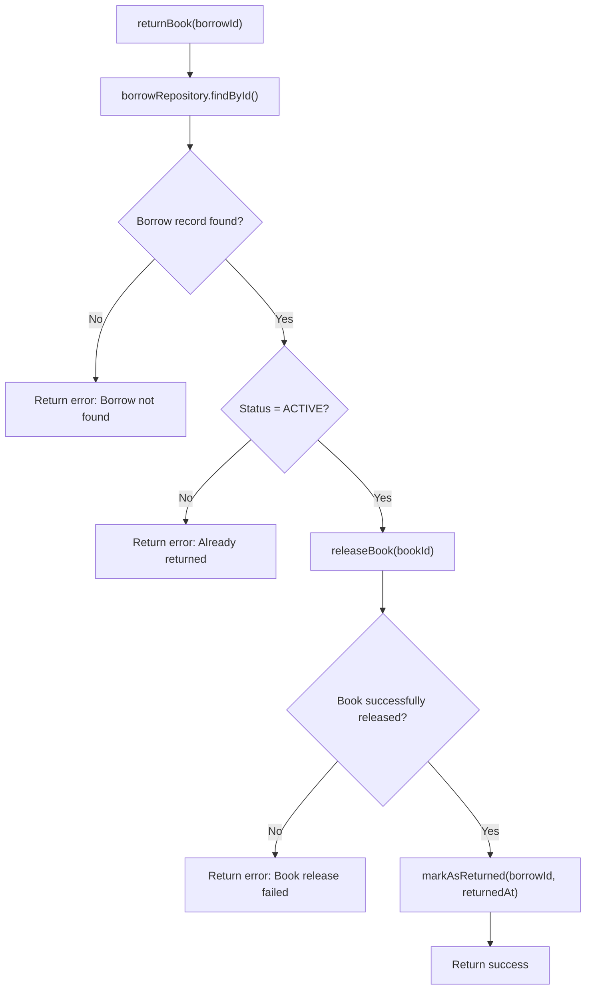
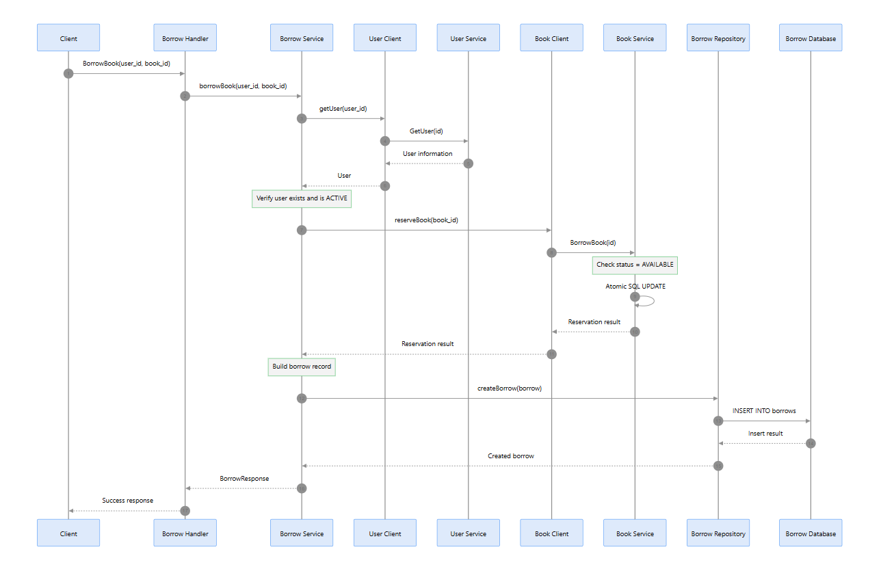

# Library Microservices System
# Système de gestion de bibliothèque — Architecture Microservices

## 1. Présentation du projet
1. Quel problème réel ce projet résout-il ?
Imagine une bibliothèque universitaire avec plusieurs centaines d'étudiants.

Elle rencontre plusieurs problèmes :
- Gestion des emprunts : éviter qu'un même livre soit emprunté simultanément par deux personnes.
- Suivi des retours : connaître les emprunts actifs, les dates limites et les retards.
- Rappels automatiques : prévenir les étudiants avant la date limite pour réduire les retards.
- Gestion des listes d'attente : prévenir les étudiants lorsqu'un livre qu'ils souhaitent emprunter redevient disponible.
- Gestion des utilisateurs : vérifier les comptes et leurs autorisations.
Notre application apporte une réponse à ces problèmes.


### 1.1. Problématique : concevoir un système distribué de gestion de bibliothèque

À première vue, un système de gestion de bibliothèque peut sembler relativement simple : les utilisateurs doivent pouvoir consulter un catalogue, rechercher des livres, emprunter des ouvrages et les retourner.

Cependant, derrière ces opérations apparemment élémentaires se trouvent plusieurs responsabilités indépendantes :

- Gérer les utilisateurs et leurs profils.
- Administrer le catalogue des livres et suivre leur disponibilité.
- Gérer les opérations d'emprunt et de retour.
- Appliquer les règles métier et garantir la cohérence des données.
- Informer les composants concernés lorsqu'une opération importante est effectuée.

À mesure que le système évolue, regrouper toutes ces responsabilités dans une seule application peut rendre le code plus difficile à maintenir, à faire évoluer et à dimensionner.

Ce projet explore comment répartir ces responsabilités entre plusieurs services indépendants, chacun étant chargé d'un domaine métier bien défini.

L'objectif n'est pas simplement de diviser une application en plusieurs petits composants. Il s'agit de comprendre comment ces services peuvent communiquer efficacement, exposer une interface unifiée aux clients et collaborer pour réaliser des opérations métier complètes.

Cette réflexion nous conduit à adopter une architecture microservices, reposant sur plusieurs technologies de communication, chacune répondant à un besoin architectural spécifique.

---

## 2. Du client à la communication entre services

Avant de présenter les microservices eux-mêmes, une première question fondamentale se pose :

**Comment permettre à un client d'interagir avec plusieurs services indépendants sans qu'il ait besoin de connaître toute l'organisation interne du backend ?**

Prenons un exemple simple : un utilisateur souhaite consulter les informations d'un livre, notamment son titre, son auteur et sa disponibilité.

Ces différentes informations peuvent nécessiter plusieurs opérations backend et impliquer différents services.

Une première approche consisterait à exposer directement chaque service au client. Celui-ci devrait alors connaître les services à contacter, les points d'accès à utiliser et la manière de combiner les informations retournées.

Cette approche présente plusieurs inconvénients :

- Le client devient fortement dépendant de l'organisation interne du backend.
- Une seule opération métier peut nécessiter plusieurs requêtes réseau.
- Le client doit prendre en charge la logique d'agrégation des données.
- Toute modification de l'organisation des services risque d'affecter l'application cliente.

Il devient donc nécessaire d'introduire une couche intermédiaire entre les clients et les microservices.

C'est dans ce contexte qu'intervient l'**API Gateway**.

### 2.1. API Gateway : un point d'entrée unique

L'API Gateway constitue le point d'entrée unique à travers lequel les clients externes accèdent au backend.

Au lieu de communiquer directement avec les différents microservices, le client adresse ses requêtes à cette passerelle.

Celle-ci se charge de diriger les requêtes vers les services appropriés et, lorsque cela est nécessaire, de coordonner leurs interactions.

Sur le plan architectural, une API Gateway peut également jouer le rôle de **Reverse Proxy** :

- Elle reçoit les requêtes entrantes des clients.
- Elle identifie leur destination.
- Elle transmet les requêtes aux services backend concernés.
- Elle retourne les réponses correspondantes au client.

Au-delà du routage, une API Gateway peut centraliser d'autres responsabilités, telles que l'authentification, la validation des requêtes, la limitation du nombre de requêtes (Rate Limiting) et la journalisation (Logging), selon son implémentation.

Dans ce projet, la passerelle joue également un rôle important en exposant différentes modalités d'interaction avec le backend à travers REST et GraphQL.

### 2.2. Pourquoi GraphQL ? Résoudre le problème d'agrégation des données

L'introduction d'une API Gateway permet de disposer d'un point d'entrée unique, mais elle ne résout pas nécessairement le problème de récupération de données provenant de plusieurs services.

Considérons le scénario suivant :

Un client souhaite récupérer les informations d'un livre ainsi que celles de son auteur.

Avec une approche REST traditionnelle, le client pourrait être amené à effectuer plusieurs requêtes :

1. Récupérer les informations du livre auprès du Book Service.
2. Récupérer les informations complémentaires auprès du service concerné.
3. Combiner les différentes réponses du côté client.

Cette approche peut multiplier les échanges réseau et transférer au frontend une partie de la responsabilité de l'agrégation des données.

GraphQL propose une autre approche.

Il permet au client de décrire précisément les données dont il a besoin à travers une seule requête. Le serveur GraphQL exécute ensuite les *resolvers* correspondants afin de récupérer les informations demandées auprès des différentes sources de données.

Prenons l'exemple de la requête GraphQL suivante :

```graphql
query {
  book(id: "book-123") {
    title
    author {
      name
    }
    availability
  }
}
```

Son exécution suit le déroulement suivant :

1. Le client envoie une requête GraphQL à l'API Gateway.
2. Le moteur GraphQL interprète les champs demandés.
3. Les resolvers associés sont exécutés.
4. Chaque resolver récupère les informations nécessaires, éventuellement en communiquant avec différents microservices.
5. GraphQL rassemble les valeurs obtenues dans une réponse unique.
6. La passerelle retourne le résultat au client.

La réponse attendue pourrait avoir la structure suivante :

```json
{
  "data": {
    "book": {
      "title": "Clean Code",
      "author": {
        "name": "Robert C. Martin"
      },
      "availability": true
    }
  }
}
```

L'idée fondamentale est la suivante : **le client décrit les informations dont il a besoin, tandis que le backend prend en charge la manière de les récupérer.**

Cette approche permet de séparer le modèle de données exposé au client de l'organisation interne des microservices.

GraphQL joue ainsi le rôle d'une couche d'agrégation des données, tandis que les resolvers implémentent la logique nécessaire à leur récupération.

Il est important de préciser que GraphQL n'impose pas de mécanisme particulier pour communiquer avec les microservices. Ce choix dépend de l'implémentation des resolvers. Dans notre projet, gRPC est utilisé pour assurer cette communication interne.

---

## 3. Choisir un protocole de communication entre microservices

Maintenant que l'API Gateway fournit un point d'entrée unifié, une autre question architecturale se pose :

**Comment les différents microservices, qui constituent des applications indépendantes, doivent-ils communiquer entre eux ?**

Une architecture microservices introduit des communications réseau entre des composants qui, dans une application monolithique, auraient éventuellement interagi à travers de simples appels de fonctions.

Par conséquent, l'efficacité des échanges, la sérialisation des données, la définition des contrats de communication et les coûts liés aux échanges réseau deviennent des éléments importants à prendre en considération.

HTTP/1.1 est largement utilisé pour les communications client-serveur, notamment à travers les API REST. Cependant, HTTP/2 apporte plusieurs améliorations qui le rendent particulièrement intéressant pour les systèmes distribués.

### 3.1. HTTP/1.1 vs HTTP/2 : comprendre l'évolution

HTTP/2 a été introduit afin d'améliorer l'efficacité des échanges HTTP sans modifier les principes fondamentaux du modèle requête-réponse.

Ses principales améliorations sont les suivantes :

**1. Le format binaire (Binary Framing)**

Contrairement à HTTP/1.1, qui utilise une représentation textuelle pour ses messages de protocole, HTTP/2 repose sur des trames binaires.

Cette organisation permet de structurer et de traiter les échanges de manière plus efficace.

Il faut toutefois distinguer le format binaire des trames HTTP/2 de la sérialisation des données applicatives : HTTP/2 ne transforme pas automatiquement les données JSON en un format plus compact.

**2. Le multiplexage (Multiplexing)**

HTTP/1.1 traite traditionnellement les requêtes de manière séquentielle sur une connexion persistante, sauf recours à d'autres mécanismes comme le pipelining ou l'utilisation de plusieurs connexions.

HTTP/2 introduit le multiplexage, qui permet à plusieurs flux indépendants d'échanger simultanément des données sur une même connexion.

Cela réduit le besoin d'établir plusieurs connexions et améliore l'utilisation des ressources réseau.

**3. La compression des en-têtes (Header Compression)**

HTTP/2 introduit HPACK, un mécanisme de compression qui réduit la surcharge liée à la transmission répétée des en-têtes HTTP.

Grâce à ces améliorations, HTTP/2 offre une communication plus efficace, notamment dans les applications impliquant des échanges fréquents entre composants distribués.

### 3.2. Pourquoi gRPC ?

HTTP/2 fournit un protocole de transport efficace, mais ne définit pas à lui seul la manière dont les microservices doivent exposer leurs opérations ni structurer leurs messages applicatifs.

Nous avons donc besoin d'un framework de communication qui apporte :

- Un contrat de communication clairement défini entre les services.
- Un mécanisme standardisé d'invocation d'opérations distantes.
- Une sérialisation efficace des messages.
- La prise en charge de différents modèles de communication, notamment le streaming.

gRPC répond à ces besoins.

gRPC est un framework de communication de type RPC (*Remote Procedure Call*) qui permet à un service d'invoquer les méthodes exposées par un autre service comme s'il s'agissait d'appels de procédures locales, alors que leur exécution se déroule réellement à travers le réseau.

Il repose sur deux technologies importantes :

**Protocol Buffers (Protobuf)**

Protocol Buffers fournit un mécanisme indépendant du langage de programmation pour définir les contrats de communication et les structures des messages à travers des fichiers `.proto`.

Au lieu d'échanger des objets JSON relativement verbeux, gRPC utilise Protocol Buffers pour sérialiser les messages dans une représentation binaire compacte.

Cela peut réduire la taille des données échangées et les coûts de sérialisation, même si les performances réelles dépendent de la charge de travail et de la structure des messages.

**HTTP/2**

gRPC utilise HTTP/2 comme protocole de transport sous-jacent.

Cela lui permet de bénéficier du multiplexage et de prendre en charge différents modèles de communication.

On distingue quatre principaux types d'appels gRPC :

- **Unary RPC :** une requête suivie d'une seule réponse.
- **Server Streaming :** une requête suivie de plusieurs réponses.
- **Client Streaming :** plusieurs requêtes suivies d'une seule réponse.
- **Bidirectional Streaming :** les deux services peuvent échanger plusieurs messages indépendamment l'un de l'autre.

Ce dernier modèle est particulièrement intéressant, car il permet aux deux parties d'envoyer des messages sans attendre que l'autre ait terminé l'intégralité de son flux.

Il faut cependant préciser que tous les appels gRPC ne nécessitent pas de communication bidirectionnelle. Le modèle classique requête-réponse est également pris en charge.

Dans ce projet, gRPC est utilisé comme mécanisme de communication interne entre l'API Gateway et les microservices.

---

## 4. Faire le lien entre la communication client et la communication interne

Nous disposons désormais de deux besoins de communication distincts :

- Les clients externes ont besoin d'une API accessible, exposée à travers REST et GraphQL.
- Les microservices ont besoin d'un mécanisme de communication interne efficace, basé sur gRPC et HTTP/2.

Ces deux couches de communication ne sont pas obligées d'utiliser le même protocole.

Par exemple, un client web peut communiquer avec l'API Gateway en HTTP/1.1, tandis que cette dernière communique avec les microservices backend à travers gRPC sur HTTP/2.

Il ne s'agit pas d'une incompatibilité entre les protocoles qui obligerait à abandonner HTTP/2 d'un côté. Il s'agit d'une frontière entre deux couches de communication, que l'API Gateway permet de gérer.

L'API Gateway joue ainsi le rôle d'intermédiaire entre ces deux modèles :

1. Elle reçoit une requête HTTP provenant du client.
2. Elle traite le point d'accès REST ou l'opération GraphQL.
3. Elle invoque les méthodes gRPC internes appropriées.
4. Elle reçoit les réponses provenant des microservices.
5. Elle transforme ou agrège les résultats lorsque cela est nécessaire.
6. Elle renvoie la réponse finale au client.

Cette séparation permet à chaque couche de communication d'utiliser le protocole le mieux adapté à ses responsabilités.

**L'API Gateway remplit donc deux fonctions architecturales essentielles :**

- Masquer la complexité du backend distribué aux clients externes.
- Assurer la liaison entre la couche API exposée aux clients et la couche de communication interne basée sur gRPC.

### 4.1. Une alternative : HTTP/1.1 avec WebSocket

HTTP/2 n'est pas le seul moyen d'obtenir une communication bidirectionnelle.

WebSocket constitue une autre solution permettant d'établir un canal de communication persistant et bidirectionnel entre un client et un serveur.

La connexion commence par une négociation HTTP. Après une mise à niveau réussie du protocole (*Protocol Upgrade*), les deux parties peuvent échanger des messages indépendamment l'une de l'autre.

Cette approche est particulièrement utile pour les applications nécessitant une communication persistante en temps réel, comme les applications de messagerie instantanée, les tableaux de bord en direct ou les outils collaboratifs.

Cependant, WebSocket et gRPC répondent à des besoins quelque peu différents :

- WebSocket fournit un canal de communication bidirectionnel généraliste.
- gRPC fournit un framework RPC structuré, reposant sur des contrats de services, Protocol Buffers et plusieurs modèles de communication, dont le streaming bidirectionnel.

Pour ce projet, gRPC a été retenu parce qu'il offre une manière structurée de définir et d'invoquer les opérations entre services indépendants, tout en tirant parti de HTTP/2.

---

## 5. Architecture de communication résultante

Les réflexions précédentes nous conduisent à l'architecture de communication suivante :

```text
                  CLIENT
                     |
                     | HTTP/1.1
                     | REST / GraphQL
                     v
              +---------------+
              |  API GATEWAY  |
              |               |
              | Express       |
              | Apollo Server |
              | GraphQL       |
              | Resolvers     |
              +---------------+
                     |
                     | gRPC over HTTP/2
                     | Protobuf
                     |
           +---------+---------+
           |         |         |
           v         v         v
       +--------+ +--------+ +---------+
       |  USER  | |  BOOK  | | BORROW  |
       | SERVICE| | SERVICE| | SERVICE |
       +--------+ +--------+ +---------+
           |         |         |
           v         v         v
         SQLite    SQLite     RxDB
```

Cette architecture établit une séparation claire entre l'accès externe à l'API et la communication interne entre les services.

L'API Gateway fournit une interface unifiée, GraphQL permet une récupération et une agrégation flexibles des données, tandis que gRPC assure une communication structurée entre les services distribués.

# Borrow Service — Architecture et fonctionnement

## 1. Présentation générale

Le **Borrow Service** est le microservice responsable de la gestion des emprunts et des retours de livres dans notre architecture de bibliothèque basée sur les microservices.

Il coordonne les opérations entre les différents services afin de garantir que les règles métier liées aux emprunts soient respectées.

Il communique principalement avec :

- **User Service** : pour vérifier l'existence et le statut d'un utilisateur.
- **Book Service** : pour vérifier la disponibilité d'un livre, le réserver ou le rendre disponible.
- **Notification Service** : pour informer les utilisateurs des événements importants, notamment lorsqu'un livre qu'ils attendent est retourné.
- **Kafka** : pour diffuser les événements métier de manière asynchrone.

### 1.1. Responsabilités de Borrow Service

Borrow Service est responsable de :

- L'enregistrement des emprunts.
- L'enregistrement des retours.
- La gestion des dates d'emprunt et des dates prévues de retour.
- La vérification de l'état d'un emprunt.
- La gestion des règles métier liées aux emprunts.
- La coordination des opérations entre User Service et Book Service.
- La publication des événements liés aux emprunts et aux retours.

Il possède sa propre base de données et ne doit jamais accéder directement aux bases de données des autres microservices.

Chaque service reste propriétaire de ses propres données.

---

## 2. Architecture et communication entre les services

Nous utilisons deux mécanismes de communication :

### 2.1. gRPC — Communication synchrone

gRPC est utilisé lorsqu'un service doit appeler directement un autre service et obtenir une réponse immédiate.

Exemples :

- Vérifier si un utilisateur existe.
- Vérifier si un livre existe.
- Vérifier la disponibilité d'un livre.
- Réserver un livre.
- Rendre un livre disponible.

Le service appelant attend la réponse avant de poursuivre son traitement.

### 2.2. Kafka — Communication asynchrone

Kafka est utilisé pour diffuser des événements métier lorsqu'une opération importante a été réalisée.

Exemple :

Lorsqu'un livre est retourné et que sa disponibilité a été mise à jour, Borrow Service publie un événement `BORROW_RETURNED`.

Notification Service consomme cet événement et peut informer les utilisateurs intéressés par ce livre.

Borrow Service n'a donc pas besoin de connaître les détails de l'envoi des notifications.

### 2.3. Vue globale

```text
                     Frontend
                         |
                         v
                    API Gateway
                         |
                         v
                   Borrow Service
                    /          \
                   /            \
                gRPC            gRPC
                 /                \
                v                  v
           User Service       Book Service
                                  |
                                  v
                            Book Database

                   Borrow Service
                         |
                         v
                       Kafka
                         |
                         v
                 Notification Service
                         |
                         v
                  User Notification
```

---

## 3. Workflow 1 : Emprunter un livre

### 3.1. Objectif

Lorsqu'un utilisateur souhaite emprunter un livre, Borrow Service coordonne les vérifications nécessaires avant d'enregistrer l'emprunt.

Le processus comprend trois grandes opérations :

1. Vérifier l'utilisateur.
2. Vérifier et réserver le livre.
3. Enregistrer l'emprunt.

### 3.2. Étape 1 — Vérifier l'utilisateur

Borrow Service communique avec User Service via gRPC.

Il vérifie :

- Si l'utilisateur existe.
- Si son compte est actif (`ACTIVE`).

Trois situations sont possibles :

| Situation | Action |
|---|---|
| Utilisateur inexistant | Refuser l'emprunt et inviter l'utilisateur à créer un compte. |
| Compte suspendu ou inactif | Refuser l'emprunt et expliquer la raison. |
| Compte actif | Continuer le processus. |

L'identité et le statut du compte sont gérés par User Service. Borrow Service ne doit pas reproduire ces informations dans sa propre base de données.

### 3.3. Étape 2 — Vérifier et réserver le livre

Borrow Service communique avec Book Service via gRPC.

Il faut distinguer trois situations :

| Situation | Action |
|---|---|
| Le livre n'existe pas | Informer l'utilisateur que le livre est absent du catalogue. |
| Le livre est disponible | Procéder à sa réservation. |
| Le livre est déjà emprunté | Rechercher la date prévue de retour dans Borrow Service. |

Si le livre est déjà emprunté, Borrow Service peut consulter son propre historique des emprunts actifs afin de retrouver la date prévue de retour.

Il peut alors informer l'utilisateur :

> Ce livre est actuellement emprunté. Sa date prévue de retour est le 20 novembre 2026.

Cette date est une date prévisionnelle : le retour réel peut être effectué plus tôt ou plus tard.

### 3.4. Étape 3 — Enregistrer l'emprunt

Si le livre est disponible et que l'opération de réservation réussit, Borrow Service enregistre un nouvel emprunt dans sa propre base de données.

Un emprunt peut contenir les attributs suivants :

| Attribut | Description |
|---|---|
| `id` | Identifiant unique de l'emprunt. |
| `user_id` | Identifiant de l'utilisateur. |
| `book_id` | Identifiant du livre. |
| `borrowed_at` | Date réelle de l'emprunt. |
| `due_date` | Date prévue de retour. |
| `returned_at` | Date réelle de retour, initialement NULL. |
| `status` | État de l'emprunt. |

Exemples de statuts :

- `ACTIVE` : emprunt en cours.
- `RETURN_PENDING` : retour en cours de traitement.
- `RETURNED` : livre retourné.

L'enregistrement de l'emprunt doit être effectué dans une transaction locale à la base de données de Borrow Service.

### 3.5. Séquence complète de l'emprunt

```text
Frontend
   |
   v
API Gateway
   |
   v
Borrow Service
   |
   |--- gRPC ---> User Service
   |                |
   |<--------------|
   |   User ACTIVE
   |
   |--- gRPC ---> Book Service
   |                |
   |                | Vérifier disponibilité
   |                | Réserver atomiquement
   |<--------------|
   |   Réservation réussie
   |
   |--- Enregistrer l'emprunt
   |    dans Borrow Database
   |
   v
Confirmation de l'emprunt
```

---

## 4. Gestion de la concurrence pendant un emprunt

### 4.1. Le problème

Imaginons qu'il ne reste qu'un seul exemplaire disponible d'un livre.

Deux utilisateurs souhaitent l'emprunter presque simultanément.

Si nous effectuons simplement une vérification suivie d'une mise à jour, nous risquons d'obtenir :

```text
Utilisateur A                 Utilisateur B
     |                              |
     v                              v
Vérifier disponibilité       Vérifier disponibilité
     |                              |
     v                              v
  AVAILABLE                    AVAILABLE
     |                              |
     v                              v
  Emprunter                     Emprunter
```

Les deux utilisateurs peuvent croire que le livre leur a été attribué.

Il s'agit d'une **condition de concurrence (race condition)**.

### 4.2. Solution : réservation atomique dans Book Service

La vérification de disponibilité et le changement de statut doivent être réalisés dans une seule opération atomique.

Borrow Service ne doit donc pas effectuer :

```text
1. Vérifier si le livre est disponible.
2. Puis demander à Book Service de le réserver.
```

Il doit plutôt appeler une opération gRPC dédiée :

```protobuf
rpc BorrowBook(BorrowBookRequest)
    returns (BorrowBookResponse);
```

Book Service réalise ensuite une mise à jour conditionnelle :

```sql
UPDATE books
SET status = 'BORROWED'
WHERE id = ?
AND status = 'AVAILABLE';
```

Puis il vérifie le nombre de lignes modifiées.

- Si `changes = 1`, la réservation a réussi.
- Si `changes = 0`, le livre n'est plus disponible ou n'existe pas.

Cette opération doit être exécutée dans une transaction de la base de données de Book Service, avec les contraintes et le niveau d'isolation adaptés au moteur utilisé.

Ainsi, même si deux requêtes arrivent simultanément, une seule peut réserver le dernier exemplaire.

**Principe essentiel : Book Service est le seul propriétaire de la disponibilité des livres.**

Pour une bibliothèque qui gère plusieurs exemplaires d'un même titre, il faudra également gérer la disponibilité au niveau de chaque exemplaire ou d'un stock atomique, et non simplement au niveau du titre.

---

## 5. Gestion des échecs pendant un emprunt

Les microservices possèdent des bases de données indépendantes. Une transaction SQL classique ne peut donc pas englober automatiquement les modifications de plusieurs services.

Il faut prévoir les scénarios d'échec.

### Scénario 1 — User Service indisponible

Borrow Service ne peut pas vérifier l'utilisateur.

**Action :**
- Ne pas continuer l'emprunt.
- Retourner une erreur temporaire au client.
- Prévoir une nouvelle tentative contrôlée.

Il ne faut surtout pas considérer automatiquement l'utilisateur comme valide.

### Scénario 2 — Book Service indisponible

Borrow Service ne peut pas confirmer la disponibilité ni réserver le livre.

**Action :**
- Ne pas enregistrer un emprunt confirmé.
- Retourner une erreur temporaire.
- Réessayer éventuellement après un délai.

### Scénario 3 — Le livre est réservé, mais l'enregistrement de l'emprunt échoue

C'est un cas important.

```text
Book Service :
Livre = BORROWED

Borrow Service :
Échec de l'enregistrement
```

Le système devient incohérent : le livre est réservé, mais aucun emprunt correspondant n'existe.

**Solution : opération de compensation Design Pattern(Saga).**

Borrow Service doit demander à Book Service d'annuler la réservation.

Par exemple :

```protobuf
rpc CancelReservation(ReservationRequest)
    returns (ReservationResponse);
```

Book Service remet le livre à disposition uniquement si la réservation correspond bien à l'opération concernée.

La compensation doit être idempotente : l'exécuter plusieurs fois ne doit pas produire d'effets incorrects.

Pour une meilleure fiabilité, on peut également enregistrer une opération de réservation avec un identifiant unique et un état temporaire, puis prévoir un mécanisme de reprise des opérations incomplètes.

---

## 6. Workflow 2 : Retourner un livre

### 6.1. Objectif

Lorsqu'un utilisateur retourne un livre, deux services doivent intervenir :

- Borrow Service : enregistrer le retour.
- Book Service : rendre le livre disponible.

Une fois le retour confirmé, les autres services intéressés peuvent être informés grâce à Kafka.

### 6.2. Étape 1 — Vérifier l'emprunt

Borrow Service vérifie dans sa propre base de données :

- Si l'emprunt existe.
- Si l'emprunt appartient au bon utilisateur, lorsque cette vérification est nécessaire.
- Si l'emprunt est toujours actif.

Si l'emprunt n'existe pas, le retour est refusé.

S'il est déjà retourné, on ne doit pas effectuer une deuxième opération de retour.

### 6.3. Étape 2 — Enregistrer le retour en cours

Borrow Service peut faire passer l'emprunt à l'état :

```text
RETURN_PENDING
```

Cet état indique que le retour a commencé, mais que la remise à disposition du livre n'a pas encore été confirmée.

Il est enregistré dans une transaction locale.

### 6.4. Étape 3 — Informer Book Service via gRPC

Borrow Service appelle :

```protobuf
rpc ReturnBook(ReturnBookRequest)
    returns (ReturnBookResponse);
```

Book Service vérifie l'état du livre et le remet à disposition :

```sql
UPDATE books
SET status = 'AVAILABLE'
WHERE id = ?
AND status = 'BORROWED';
```

L'opération doit être sécurisée et idempotente.

### 6.5. Étape 4 — Confirmer le retour

Lorsque Book Service confirme la remise à disposition :

Borrow Service met à jour son emprunt :

```text
status = RETURNED
returned_at = date actuelle
```

Le retour est maintenant confirmé.

### 6.6. Séquence complète du retour

```text
Frontend
   |
   v
API Gateway
   |
   v
Borrow Service
   |
   | Vérifier l'emprunt
   |
   | Enregistrer RETURN_PENDING
   |
   |--- gRPC ---> Book Service
   |                |
   |                | Mettre le livre AVAILABLE
   |<--------------|
   |  Confirmation
   |
   | Enregistrer RETURNED
   | et returned_at
   |
   v
Publier BORROW_RETURNED
dans Kafka
```

---

## 7. Gestion des échecs pendant un retour

Le retour implique deux bases de données indépendantes. Il faut donc gérer les échecs entre les étapes.

### Scénario 1 — Book Service est indisponible

Borrow Service a enregistré :

```text
status = RETURN_PENDING
```

Mais Book Service n'a pas pu rendre le livre disponible.

**Action :**

- Ne pas confirmer le retour comme terminé.
- Conserver l'état `RETURN_PENDING`.
- Réessayer l'appel gRPC de manière contrôlée.
- Utiliser un mécanisme de reprise pour traiter les retours en attente.

Le système doit permettre de retrouver les opérations qui n'ont pas abouti.

### Scénario 2 — Book Service a rendu le livre disponible, mais Borrow Service n'a pas pu confirmer le retour

On peut avoir :

```text
Book Service :
AVAILABLE

Borrow Service :
RETURN_PENDING
```

C'est une situation de cohérence temporaire.

**Solution : idempotence et reprise.**

Borrow Service peut réessayer l'appel `ReturnBook`.

Book Service doit reconnaître que le retour a déjà été traité et ne pas produire une nouvelle modification incorrecte.

Ensuite, Borrow Service peut finaliser son enregistrement en `RETURNED`.

Il est préférable de transmettre un identifiant d'opération unique (`return_id`) pour reconnaître les appels répétés.

### Scénario 3 — Le service tombe en panne pendant le traitement

Un mécanisme de récupération doit rechercher périodiquement les emprunts restés en `RETURN_PENDING`.

Il peut alors reprendre le traitement, vérifier l'état du livre auprès de Book Service et finaliser l'opération si les conditions sont réunies.

Cette stratégie évite de perdre définitivement une opération simplement parce qu'un service a redémarré au mauvais moment.

---

## 8. Kafka : annoncer le retour d'un livre

### 8.1. Pourquoi utiliser Kafka ?

Lorsqu'un livre est retourné, d'autres services peuvent avoir besoin de réagir.

Par exemple :

- Notification Service doit informer les utilisateurs intéressés.
- Un futur service de statistiques peut mettre à jour ses indicateurs.
- Un futur service de gestion des listes d'attente peut proposer le livre à la prochaine personne.

Il serait peu pratique que Borrow Service appelle directement chacun de ces services.

À la place, il publie un événement métier dans Kafka.

### 8.2. Événement publié

Après confirmation du retour, Borrow Service publie :

```text
Topic : borrow-events

Event : BORROW_RETURNED
```

Exemple de payload :

```json
{
  "eventId": "event-123",
  "eventType": "BORROW_RETURNED",
  "borrowId": "borrow-456",
  "bookId": "book-123",
  "userId": "user-789",
  "returnedAt": "2026-11-13T12:30:00Z"
}
```

L'événement indique qu'un retour a été effectué.

Il ne s'agit pas d'une commande demandant à Book Service de modifier la disponibilité : cette responsabilité a déjà été traitée via gRPC.

### 8.3. Notification Service

Notification Service consomme les événements du topic `borrow-events`.

Lorsqu'il reçoit `BORROW_RETURNED`, il peut :

1. Identifier les utilisateurs qui ont demandé à être informés du retour de ce livre.
2. Vérifier les éventuelles règles de priorité.
3. Envoyer une notification.

Exemple :

> Le livre que vous attendiez est maintenant disponible !

Borrow Service n'a pas besoin de connaître le fonctionnement interne de Notification Service.

### 8.4. Garantir la publication de l'événement : Transactional Outbox

Un problème peut se produire :

```text
Borrow Service :
Retour confirmé dans la base de données.

Kafka :
Indisponible au moment de publier l'événement.
```

Le retour est enregistré, mais aucune notification ne sera déclenchée si l'événement est perdu.

Pour éviter cela, on peut utiliser le **Transactional Outbox Pattern**.

Principe :

1. Borrow Service confirme le retour dans sa base de données.
2. Dans la même transaction SQL, il insère un événement dans une table `outbox_events`.
3. Un processus indépendant lit les événements non publiés.
4. Il les publie dans Kafka.
5. Une fois la publication confirmée, il marque l'événement comme publié.

Exemple de table :

| Attribut | Description |
|---|---|
| `id` | Identifiant de l'événement |
| `event_type` | Type de l'événement |
| `payload` | Contenu JSON |
| `created_at` | Date de création |
| `published_at` | Date de publication, NULL si non publié |
| `status` | PENDING ou PUBLISHED |

Ainsi, si Kafka est temporairement indisponible, l'événement reste dans la base de données et pourra être publié plus tard.

Attention : le consommateur Kafka doit également être idempotent, car un événement peut être livré plusieurs fois.

---

## 9. Saga Pattern et cohérence distribuée

### 9.1. Pourquoi une Saga ?

Dans une architecture microservices, chaque service possède sa propre base de données.

Une transaction SQL classique ne peut pas garantir automatiquement que plusieurs bases de données seront modifiées ensemble.

Par exemple, un emprunt implique :

- Une réservation dans Book Service.
- Un enregistrement dans Borrow Service.

Si une opération réussit et l'autre échoue, le système doit pouvoir revenir à un état cohérent.

Le Saga Pattern consiste à découper une opération métier distribuée en plusieurs transactions locales, avec des opérations de compensation lorsque cela est nécessaire.

### 9.2. Saga pour l'emprunt

```text
1. Vérifier User Service
          |
          v
2. Réserver le livre dans Book Service
          |
          v
3. Enregistrer l'emprunt dans Borrow Service
          |
          v
       SUCCÈS
```

Si l'étape 3 échoue :

```text
3. Enregistrement échoué
          |
          v
4. Compensation :
   Annuler la réservation dans Book Service
```

### 9.3. Saga pour le retour

```text
1. Enregistrer RETURN_PENDING
          |
          v
2. Rendre le livre AVAILABLE
   dans Book Service
          |
          v
3. Confirmer RETURNED
   dans Borrow Service
          |
          v
4. Enregistrer l'événement
   dans l'Outbox
          |
          v
5. Publier dans Kafka
```

Si une étape échoue, l'opération doit être reprise à partir de son état connu.

Pour le retour, il est généralement préférable de reprendre une étape incomplète plutôt que de tenter de ré-emprunter ou de modifier arbitrairement l'état du livre.

---

## 10. Principes techniques à respecter

Pour rendre Borrow Service fiable, plusieurs principes doivent être appliqués.

### 10.1. Idempotence

Une opération est idempotente lorsque son exécution plusieurs fois produit le même résultat métier qu'une seule exécution.

Exemple :

Si un retour est demandé deux fois à cause d'un timeout réseau, le système ne doit pas enregistrer deux retours différents.

On peut utiliser :

- Un identifiant unique d'opération.
- Des vérifications d'état avant chaque modification.
- Des contraintes d'unicité dans la base de données.

### 10.2. Timeouts et retries

Les appels gRPC doivent avoir des délais d'attente (`deadline`).

En cas d'échec temporaire, on peut réessayer avec un délai progressif (exponential backoff).

Attention : un timeout ne signifie pas toujours que l'opération distante n'a pas été exécutée. Le serveur peut avoir terminé l'opération sans que le client ait reçu la réponse.

C'est pourquoi les retries doivent être associés à des opérations idempotentes.

### 10.3. Contraintes en base de données

Quelques contraintes utiles :

- Clés étrangères lorsque les identifiants sont gérés dans la même base.
- Identifiants uniques pour les emprunts et les opérations.
- Contrôle des états autorisés.
- Une seule opération d'emprunt active par exemplaire.
- Transactions locales pour les modifications liées.

Il faut noter que les identifiants `user_id` et `book_id` appartiennent à d'autres microservices. On ne doit pas créer des clés étrangères SQL vers leurs bases de données indépendantes.

### 10.4. Journalisation

Chaque opération importante doit être journalisée avec des identifiants de corrélation.

Exemples :

```text
[Borrow] Request received
[Borrow] User verified
[Borrow] Book reservation successful
[Borrow] Borrow record created
[Return] Return initiated
[Return] Book availability updated
[Return] Return confirmed
[Kafka] BORROW_RETURNED published
```

Ces logs facilitent le diagnostic lorsqu'une opération distribuée échoue.

---

## 11. Répartition finale des responsabilités

| Service | Responsabilité |
|---|---|
| User Service | Gestion des utilisateurs et de leur statut |
| Book Service | Gestion du catalogue et de la disponibilité |
| Borrow Service | Gestion des emprunts, retours et échéances |
| Notification Service | Envoi des notifications |
| Kafka | Diffusion asynchrone des événements |

### Répartition des communications

| Opération | Mécanisme |
|---|---|
| Vérifier un utilisateur | gRPC |
| Vérifier l'existence d'un livre | gRPC |
| Réserver un livre | gRPC |
| Enregistrer un emprunt | Base de Borrow Service |
| Rendre un livre disponible | gRPC |
| Enregistrer un retour | Base de Borrow Service |
| Annoncer un retour | Kafka |
| Envoyer une notification | Notification Service |

---
BorrowService
    |
    +---- UserService (gRPC)
    |        |
    |        +---- GetUser()
    |
    +---- BookService (gRPC)
    |        |
    |        +---- BorrowBook()
    |        +---- ReturnBook()
    |
    +---- BorrowRepository
             |
             +---- SQLite

## Conclusion

Borrow Service joue le rôle de coordinateur métier pour les emprunts et les retours.

**gRPC** permet de réaliser les communications directes qui nécessitent une réponse immédiate, notamment les vérifications et les changements de disponibilité.

**Kafka** permet de diffuser les événements métier après leur réalisation, sans coupler Borrow Service aux services qui souhaitent réagir à ces événements.

La concurrence est gérée au niveau du service propriétaire de la ressource : Book Service protège atomiquement la disponibilité des livres.

Enfin, le Saga Pattern, l'idempotence, les retries et le Transactional Outbox permettent de rendre les opérations distribuées plus fiables malgré les pannes et les problèmes de communication.

L'objectif n'est pas de garantir qu'aucun service ne tombera jamais en panne, mais de concevoir un système capable de détecter les opérations incomplètes, de les reprendre et de retrouver un état cohérent.
## **Return Book Workflow**

When a user returns a book, they provide the borrow record identifier (`borrow_id`).

The **BorrowService** is responsible for coordinating the return process:

1. Retrieve the borrow record from its own database using `borrow_id`.
2. Verify that the borrow record exists.
3. Check that its status is `ACTIVE`.
4. Ask the **BookService** to release the book and change its status to `AVAILABLE`.
5. Update the borrow record in its own database by changing its status to `RETURNED`.
6. Record the return date (`returned_at`).

### Workflow Diagram


### Why This Execution Order?

**1. Why retrieve the borrow record before calling BookService?**

Because each microservice owns its own business data.

- **BookService** manages book availability and knows whether a book is `AVAILABLE`, `BORROWED` or `UNAVAILABLE`.
- **BorrowService** manages borrow records and knows whether a borrow exists and whether it is still `ACTIVE`.

Therefore, BorrowService must first retrieve the borrow record and verify its status before requesting the book release.

**2. Why call BookService before updating the borrow record?**

We must not mark a borrow as `RETURNED` if BookService has failed to release the book.

The execution order is therefore:

```text
BookService.ReturnBook()
          |
          v
BorrowRepository.markAsReturned()
```

First, BookService changes the book status to `AVAILABLE`. Only after a successful response does BorrowService update its local borrow record to `RETURNED`.

**3. What happens if the second operation fails?**

This execution order does not guarantee distributed transaction consistency.

For example:

1. BookService successfully releases the book.
2. BorrowService encounters an SQLite error while updating the borrow record.
3. The book is now `AVAILABLE`, but the borrow record remains `ACTIVE`.

This creates an inconsistency between the two microservices.

A more robust implementation will address this problem using:
- **Saga Pattern** to coordinate distributed operations.
- **Compensation operations** to handle failures.
- **Operation IDs** to identify and safely retry operations.
- **Kafka + Transactional Outbox** for reliable event publishing.
### Service Responsibilities

| Component | Responsibility |
|---|---|
| `BorrowService` | Orchestrates the return workflow |
| `borrowRepository.findById()` | Retrieves the borrow record |
| `BookService.ReturnBook()` | Changes the book status to `AVAILABLE` |
| `borrowRepository.markAsReturned()` | Changes the borrow status to `RETURNED` and records `returned_at` |

### Important: Distributed Consistency

The return operation involves two independent microservices and their databases.

If BookService successfully releases the book but BorrowService fails to update its own database, an inconsistency may occur.

This is a distributed consistency problem that can be addressed later using **Saga Pattern**, compensation operations and reliable event publishing with **Kafka (Transactional Outbox)**.

## Borrow Book Workflow

The BorrowService acts as the orchestrator of the borrowing process. It coordinates UserService and BookService through synchronous gRPC communication while maintaining ownership of borrowing records in its own SQLite database.

### Workflow

1. **Receive Borrow Request**
   - The client sends a `BorrowBook` gRPC request containing `user_id` and `book_id`.
   - The Borrow Handler forwards the request to `borrowService.borrowBook()`.

2. **Validate User**
   - BorrowService calls `UserService.GetUser()` through its gRPC client.
   - UserService retrieves the user from its own database.
   - BorrowService verifies that the user exists and that `account_status` is `ACTIVE`.
   - If validation fails, the borrowing process stops.

3. **Reserve Book**
   - BorrowService calls `BookService.BorrowBook()` through its gRPC client.
   - BookService performs an atomic conditional SQL update:
   
   ```sql
   UPDATE books
   SET status = 'BORROWED'
   WHERE id = ?
   AND status = 'AVAILABLE';
   ```

   - The reservation succeeds only if the book exists and is currently available.
   - This prevents two concurrent requests from successfully reserving the same book.

   **Note:** `CheckAvailability()` is available for informational queries but is not required before `BorrowBook()`, since the reservation operation performs its own availability check atomically.

4. **Create Borrow Record**
   - Once the reservation succeeds, BorrowService generates a unique borrow ID.
   - It sets the borrowing date, a due date (14 days later), and the initial status (`ACTIVE`).
   - `borrowRepository.createBorrow()` persists the record in BorrowService's own SQLite database.

5. **Return Response**
   - BorrowService returns a success response containing the created borrow record.
   - The Borrow Handler forwards the response to the original client.

### Compensation on Failure

If the book has been successfully reserved but persisting the borrow record fails, BorrowService attempts to compensate by calling `BookService.ReturnBook()` to release the book.

This is a simplified implementation of the Saga pattern, where a compensating action attempts to undo a previously completed operation.

### Service Responsibilities

| Service | Responsibility |
|---|---|
| UserService | User existence and account status validation |
| BookService | Book availability and reservation |
| BorrowService | Borrowing workflow orchestration and borrow record persistence |

Each microservice owns its own database. BorrowService never accesses UserService's or BookService's database directly.



\# Library Microservices System

\# Système de gestion de bibliothèque — Architecture Microservices


\## 1. Présentation du projet


\### 1.1. Problématique : concevoir un système distribué de gestion de bibliothèque


À première vue, un système de gestion de bibliothèque peut sembler relativement simple : les utilisateurs doivent pouvoir consulter un catalogue, rechercher des livres, emprunter des ouvrages et les retourner.


Cependant, derrière ces opérations apparemment élémentaires se trouvent plusieurs responsabilités indépendantes :


\- Gérer les utilisateurs et leurs profils.

\- Administrer le catalogue des livres et suivre leur disponibilité.

\- Gérer les opérations d'emprunt et de retour.

\- Appliquer les règles métier et garantir la cohérence des données.

\- Informer les composants concernés lorsqu'une opération importante est effectuée.


À mesure que le système évolue, regrouper toutes ces responsabilités dans une seule application peut rendre le code plus difficile à maintenir, à faire évoluer et à dimensionner.


Ce projet explore comment répartir ces responsabilités entre plusieurs services indépendants, chacun étant chargé d'un domaine métier bien défini.


L'objectif n'est pas simplement de diviser une application en plusieurs petits composants. Il s'agit de comprendre comment ces services peuvent communiquer efficacement, exposer une interface unifiée aux clients et collaborer pour réaliser des opérations métier complètes.


Cette réflexion nous conduit à adopter une architecture microservices, reposant sur plusieurs technologies de communication, chacune répondant à un besoin architectural spécifique.


\---


\## 2. Du client à la communication entre services


Avant de présenter les microservices eux-mêmes, une première question fondamentale se pose :


**\*\*Comment permettre à un client d'interagir avec plusieurs services indépendants sans qu'il ait besoin de connaître toute l'organisation interne du backend ?\*\***


Prenons un exemple simple : un utilisateur souhaite consulter les informations d'un livre, notamment son titre, son auteur et sa disponibilité.


Ces différentes informations peuvent nécessiter plusieurs opérations backend et impliquer différents services.


Une première approche consisterait à exposer directement chaque service au client. Celui-ci devrait alors connaître les services à contacter, les points d'accès à utiliser et la manière de combiner les informations retournées.


Cette approche présente plusieurs inconvénients :


\- Le client devient fortement dépendant de l'organisation interne du backend.

\- Une seule opération métier peut nécessiter plusieurs requêtes réseau.

\- Le client doit prendre en charge la logique d'agrégation des données.

\- Toute modification de l'organisation des services risque d'affecter l'application cliente.


Il devient donc nécessaire d'introduire une couche intermédiaire entre les clients et les microservices.


C'est dans ce contexte qu'intervient l'**\*\*API Gateway\*\***.


\### 2.1. API Gateway : un point d'entrée unique


L'API Gateway constitue le point d'entrée unique à travers lequel les clients externes accèdent au backend.


Au lieu de communiquer directement avec les différents microservices, le client adresse ses requêtes à cette passerelle.


Celle-ci se charge de diriger les requêtes vers les services appropriés et, lorsque cela est nécessaire, de coordonner leurs interactions.


Sur le plan architectural, une API Gateway peut également jouer le rôle de **\*\*Reverse Proxy\*\*** :


\- Elle reçoit les requêtes entrantes des clients.

\- Elle identifie leur destination.

\- Elle transmet les requêtes aux services backend concernés.

\- Elle retourne les réponses correspondantes au client.


Au-delà du routage, une API Gateway peut centraliser d'autres responsabilités, telles que l'authentification, la validation des requêtes, la limitation du nombre de requêtes (Rate Limiting) et la journalisation (Logging), selon son implémentation.


Dans ce projet, la passerelle joue également un rôle important en exposant différentes modalités d'interaction avec le backend à travers REST et GraphQL.


\### 2.2. Pourquoi GraphQL ? Résoudre le problème d'agrégation des données


L'introduction d'une API Gateway permet de disposer d'un point d'entrée unique, mais elle ne résout pas nécessairement le problème de récupération de données provenant de plusieurs services.


Considérons le scénario suivant :


Un client souhaite récupérer les informations d'un livre ainsi que celles de son auteur.


Avec une approche REST traditionnelle, le client pourrait être amené à effectuer plusieurs requêtes :


1\. Récupérer les informations du livre auprès du Book Service.

2\. Récupérer les informations complémentaires auprès du service concerné.

3\. Combiner les différentes réponses du côté client.


Cette approche peut multiplier les échanges réseau et transférer au frontend une partie de la responsabilité de l'agrégation des données.


GraphQL propose une autre approche.


Il permet au client de décrire précisément les données dont il a besoin à travers une seule requête. Le serveur GraphQL exécute ensuite les *\*resolvers\** correspondants afin de récupérer les informations demandées auprès des différentes sources de données.


Prenons l'exemple de la requête GraphQL suivante :


\`\`\`graphql

query {

  book(id: "book-123") {

    title

    author {

      name

    }

    availability

  }

}

\`\`\`


Son exécution suit le déroulement suivant :


1\. Le client envoie une requête GraphQL à l'API Gateway.

2\. Le moteur GraphQL interprète les champs demandés.

3\. Les resolvers associés sont exécutés.

4\. Chaque resolver récupère les informations nécessaires, éventuellement en communiquant avec différents microservices.

5\. GraphQL rassemble les valeurs obtenues dans une réponse unique.

6\. La passerelle retourne le résultat au client.


La réponse attendue pourrait avoir la structure suivante :


\`\`\`json

{

  "data": {

    "book": {

      "title": "Clean Code",

      "author": {

        "name": "Robert C. Martin"

      },

      "availability": true

    }

  }

}

\`\`\`


L'idée fondamentale est la suivante : **\*\*le client décrit les informations dont il a besoin, tandis que le backend prend en charge la manière de les récupérer.\*\***


Cette approche permet de séparer le modèle de données exposé au client de l'organisation interne des microservices.


GraphQL joue ainsi le rôle d'une couche d'agrégation des données, tandis que les resolvers implémentent la logique nécessaire à leur récupération.


Il est important de préciser que GraphQL n'impose pas de mécanisme particulier pour communiquer avec les microservices. Ce choix dépend de l'implémentation des resolvers. Dans notre projet, gRPC est utilisé pour assurer cette communication interne.


\---


\## 3. Choisir un protocole de communication entre microservices


Maintenant que l'API Gateway fournit un point d'entrée unifié, une autre question architecturale se pose :


**\*\*Comment les différents microservices, qui constituent des applications indépendantes, doivent-ils communiquer entre eux ?\*\***


Une architecture microservices introduit des communications réseau entre des composants qui, dans une application monolithique, auraient éventuellement interagi à travers de simples appels de fonctions.


Par conséquent, l'efficacité des échanges, la sérialisation des données, la définition des contrats de communication et les coûts liés aux échanges réseau deviennent des éléments importants à prendre en considération.


HTTP/1.1 est largement utilisé pour les communications client-serveur, notamment à travers les API REST. Cependant, HTTP/2 apporte plusieurs améliorations qui le rendent particulièrement intéressant pour les systèmes distribués.


\### 3.1. HTTP/1.1 vs HTTP/2 : comprendre l'évolution


HTTP/2 a été introduit afin d'améliorer l'efficacité des échanges HTTP sans modifier les principes fondamentaux du modèle requête-réponse.


Ses principales améliorations sont les suivantes :


**\*\*1. Le format binaire (Binary Framing)\*\***


Contrairement à HTTP/1.1, qui utilise une représentation textuelle pour ses messages de protocole, HTTP/2 repose sur des trames binaires.


Cette organisation permet de structurer et de traiter les échanges de manière plus efficace.


Il faut toutefois distinguer le format binaire des trames HTTP/2 de la sérialisation des données applicatives : HTTP/2 ne transforme pas automatiquement les données JSON en un format plus compact.


**\*\*2. Le multiplexage (Multiplexing)\*\***


HTTP/1.1 traite traditionnellement les requêtes de manière séquentielle sur une connexion persistante, sauf recours à d'autres mécanismes comme le pipelining ou l'utilisation de plusieurs connexions.


HTTP/2 introduit le multiplexage, qui permet à plusieurs flux indépendants d'échanger simultanément des données sur une même connexion.


Cela réduit le besoin d'établir plusieurs connexions et améliore l'utilisation des ressources réseau.


**\*\*3. La compression des en-têtes (Header Compression)\*\***


HTTP/2 introduit HPACK, un mécanisme de compression qui réduit la surcharge liée à la transmission répétée des en-têtes HTTP.


Grâce à ces améliorations, HTTP/2 offre une communication plus efficace, notamment dans les applications impliquant des échanges fréquents entre composants distribués.


\### 3.2. Pourquoi gRPC ?


HTTP/2 fournit un protocole de transport efficace, mais ne définit pas à lui seul la manière dont les microservices doivent exposer leurs opérations ni structurer leurs messages applicatifs.


Nous avons donc besoin d'un framework de communication qui apporte :


\- Un contrat de communication clairement défini entre les services.

\- Un mécanisme standardisé d'invocation d'opérations distantes.

\- Une sérialisation efficace des messages.

\- La prise en charge de différents modèles de communication, notamment le streaming.


gRPC répond à ces besoins.


gRPC est un framework de communication de type RPC (*\*Remote Procedure Call\**) qui permet à un service d'invoquer les méthodes exposées par un autre service comme s'il s'agissait d'appels de procédures locales, alors que leur exécution se déroule réellement à travers le réseau.


Il repose sur deux technologies importantes :


**\*\*Protocol Buffers (Protobuf)\*\***


Protocol Buffers fournit un mécanisme indépendant du langage de programmation pour définir les contrats de communication et les structures des messages à travers des fichiers \`.proto\`.


Au lieu d'échanger des objets JSON relativement verbeux, gRPC utilise Protocol Buffers pour sérialiser les messages dans une représentation binaire compacte.


Cela peut réduire la taille des données échangées et les coûts de sérialisation, même si les performances réelles dépendent de la charge de travail et de la structure des messages.


**\*\*HTTP/2\*\***


gRPC utilise HTTP/2 comme protocole de transport sous-jacent.


Cela lui permet de bénéficier du multiplexage et de prendre en charge différents modèles de communication.


On distingue quatre principaux types d'appels gRPC :


\- **\*\*Unary RPC :\*\*** une requête suivie d'une seule réponse.

\- **\*\*Server Streaming :\*\*** une requête suivie de plusieurs réponses.

\- **\*\*Client Streaming :\*\*** plusieurs requêtes suivies d'une seule réponse.

\- **\*\*Bidirectional Streaming :\*\*** les deux services peuvent échanger plusieurs messages indépendamment l'un de l'autre.


Ce dernier modèle est particulièrement intéressant, car il permet aux deux parties d'envoyer des messages sans attendre que l'autre ait terminé l'intégralité de son flux.


Il faut cependant préciser que tous les appels gRPC ne nécessitent pas de communication bidirectionnelle. Le modèle classique requête-réponse est également pris en charge.


Dans ce projet, gRPC est utilisé comme mécanisme de communication interne entre l'API Gateway et les microservices.


\---


\## 4. Faire le lien entre la communication client et la communication interne


Nous disposons désormais de deux besoins de communication distincts :


\- Les clients externes ont besoin d'une API accessible, exposée à travers REST et GraphQL.

\- Les microservices ont besoin d'un mécanisme de communication interne efficace, basé sur gRPC et HTTP/2.


Ces deux couches de communication ne sont pas obligées d'utiliser le même protocole.


Par exemple, un client web peut communiquer avec l'API Gateway en HTTP/1.1, tandis que cette dernière communique avec les microservices backend à travers gRPC sur HTTP/2.


Il ne s'agit pas d'une incompatibilité entre les protocoles qui obligerait à abandonner HTTP/2 d'un côté. Il s'agit d'une frontière entre deux couches de communication, que l'API Gateway permet de gérer.


L'API Gateway joue ainsi le rôle d'intermédiaire entre ces deux modèles :


1\. Elle reçoit une requête HTTP provenant du client.

2\. Elle traite le point d'accès REST ou l'opération GraphQL.

3\. Elle invoque les méthodes gRPC internes appropriées.

4\. Elle reçoit les réponses provenant des microservices.

5\. Elle transforme ou agrège les résultats lorsque cela est nécessaire.

6\. Elle renvoie la réponse finale au client.


Cette séparation permet à chaque couche de communication d'utiliser le protocole le mieux adapté à ses responsabilités.


**\*\*L'API Gateway remplit donc deux fonctions architecturales essentielles :\*\***


\- Masquer la complexité du backend distribué aux clients externes.

\- Assurer la liaison entre la couche API exposée aux clients et la couche de communication interne basée sur gRPC.


\### 4.1. Une alternative : HTTP/1.1 avec WebSocket


HTTP/2 n'est pas le seul moyen d'obtenir une communication bidirectionnelle.


WebSocket constitue une autre solution permettant d'établir un canal de communication persistant et bidirectionnel entre un client et un serveur.


La connexion commence par une négociation HTTP. Après une mise à niveau réussie du protocole (*\*Protocol Upgrade\**), les deux parties peuvent échanger des messages indépendamment l'une de l'autre.


Cette approche est particulièrement utile pour les applications nécessitant une communication persistante en temps réel, comme les applications de messagerie instantanée, les tableaux de bord en direct ou les outils collaboratifs.


Cependant, WebSocket et gRPC répondent à des besoins quelque peu différents :


\- WebSocket fournit un canal de communication bidirectionnel généraliste.

\- gRPC fournit un framework RPC structuré, reposant sur des contrats de services, Protocol Buffers et plusieurs modèles de communication, dont le streaming bidirectionnel.


Pour ce projet, gRPC a été retenu parce qu'il offre une manière structurée de définir et d'invoquer les opérations entre services indépendants, tout en tirant parti de HTTP/2.


\---


\## 5. Architecture de communication résultante


Les réflexions précédentes nous conduisent à l'architecture de communication suivante :


\`\`\`text

                  CLIENT

                     |

                     | HTTP/1.1

                     | REST / GraphQL

                     v

              +---------------+

              |  API GATEWAY  |

              |               |

              | Express       |

              | Apollo Server |

              | GraphQL       |

              | Resolvers     |

              +---------------+

                     |

                     | gRPC over HTTP/2

                     | Protobuf

                     |

           +---------+---------+

           |         |         |

           v         v         v

       +--------+ +--------+ +---------+

       |  USER  | |  BOOK  | | BORROW  |

       | SERVICE| | SERVICE| | SERVICE |

       +--------+ +--------+ +---------+

           |         |         |

           v         v         v

         SQLite    SQLite     RxDB

\`\`\`


Cette architecture établit une séparation claire entre l'accès externe à l'API et la communication interne entre les services.


L'API Gateway fournit une interface unifiée, GraphQL permet une récupération et une agrégation flexibles des données, tandis que gRPC assure une communication structurée entre les services distribués.


\# Borrow Service — Architecture et fonctionnement


\## 1. Présentation générale


Le **\*\*Borrow Service\*\*** est le microservice responsable de la gestion des emprunts et des retours de livres dans notre architecture de bibliothèque basée sur les microservices.


Il coordonne les opérations entre les différents services afin de garantir que les règles métier liées aux emprunts soient respectées.


Il communique principalement avec :


\- **\*\*User Service\*\*** : pour vérifier l'existence et le statut d'un utilisateur.

\- **\*\*Book Service\*\*** : pour vérifier la disponibilité d'un livre, le réserver ou le rendre disponible.

\- **\*\*Notification Service\*\*** : pour informer les utilisateurs des événements importants, notamment lorsqu'un livre qu'ils attendent est retourné.

\- **\*\*Kafka\*\*** : pour diffuser les événements métier de manière asynchrone.


\### 1.1. Responsabilités de Borrow Service


Borrow Service est responsable de :


\- L'enregistrement des emprunts.

\- L'enregistrement des retours.

\- La gestion des dates d'emprunt et des dates prévues de retour.

\- La vérification de l'état d'un emprunt.

\- La gestion des règles métier liées aux emprunts.

\- La coordination des opérations entre User Service et Book Service.

\- La publication des événements liés aux emprunts et aux retours.


Il possède sa propre base de données et ne doit jamais accéder directement aux bases de données des autres microservices.


Chaque service reste propriétaire de ses propres données.


\---


\## 2. Architecture et communication entre les services


Nous utilisons deux mécanismes de communication :


\### 2.1. gRPC — Communication synchrone


gRPC est utilisé lorsqu'un service doit appeler directement un autre service et obtenir une réponse immédiate.


Exemples :


\- Vérifier si un utilisateur existe.

\- Vérifier si un livre existe.

\- Vérifier la disponibilité d'un livre.

\- Réserver un livre.

\- Rendre un livre disponible.


Le service appelant attend la réponse avant de poursuivre son traitement.


\### 2.2. Kafka — Communication asynchrone


Kafka est utilisé pour diffuser des événements métier lorsqu'une opération importante a été réalisée.


Exemple :


Lorsqu'un livre est retourné et que sa disponibilité a été mise à jour, Borrow Service publie un événement \`BORROW_RETURNED\`.


Notification Service consomme cet événement et peut informer les utilisateurs intéressés par ce livre.


Borrow Service n'a donc pas besoin de connaître les détails de l'envoi des notifications.


\### 2.3. Vue globale


\`\`\`text

                     Frontend

                         |

                         v

                    API Gateway

                         |

                         v

                   Borrow Service

                    /          \\

                   /            \\

                gRPC            gRPC

                 /                \\

                v                  v

           User Service       Book Service

                                  |

                                  v

                            Book Database


                   Borrow Service

                         |

                         v

                       Kafka

                         |

                         v

                 Notification Service

                         |

                         v

                  User Notification

\`\`\`


\---


\## 3. Workflow 1 : Emprunter un livre


\### 3.1. Objectif


Lorsqu'un utilisateur souhaite emprunter un livre, Borrow Service coordonne les vérifications nécessaires avant d'enregistrer l'emprunt.


Le processus comprend trois grandes opérations :


1\. Vérifier l'utilisateur.

2\. Vérifier et réserver le livre.

3\. Enregistrer l'emprunt.


\### 3.2. Étape 1 — Vérifier l'utilisateur


Borrow Service communique avec User Service via gRPC.


Il vérifie :


\- Si l'utilisateur existe.

\- Si son compte est actif (\`ACTIVE\`).


Trois situations sont possibles :


\| Situation | Action |

\|---|---|

\| Utilisateur inexistant | Refuser l'emprunt et inviter l'utilisateur à créer un compte. |

\| Compte suspendu ou inactif | Refuser l'emprunt et expliquer la raison. |

\| Compte actif | Continuer le processus. |


L'identité et le statut du compte sont gérés par User Service. Borrow Service ne doit pas reproduire ces informations dans sa propre base de données.


\### 3.3. Étape 2 — Vérifier et réserver le livre


Borrow Service communique avec Book Service via gRPC.


Il faut distinguer trois situations :


\| Situation | Action |

\|---|---|

\| Le livre n'existe pas | Informer l'utilisateur que le livre est absent du catalogue. |

\| Le livre est disponible | Procéder à sa réservation. |

\| Le livre est déjà emprunté | Rechercher la date prévue de retour dans Borrow Service. |


Si le livre est déjà emprunté, Borrow Service peut consulter son propre historique des emprunts actifs afin de retrouver la date prévue de retour.


Il peut alors informer l'utilisateur :


*> Ce livre est actuellement emprunté. Sa date prévue de retour est le 20 novembre 2026.*


Cette date est une date prévisionnelle : le retour réel peut être effectué plus tôt ou plus tard.


\### 3.4. Étape 3 — Enregistrer l'emprunt


Si le livre est disponible et que l'opération de réservation réussit, Borrow Service enregistre un nouvel emprunt dans sa propre base de données.


Un emprunt peut contenir les attributs suivants :


\| Attribut | Description |

\|---|---|

\| \`id\` | Identifiant unique de l'emprunt. |

\| \`user_id\` | Identifiant de l'utilisateur. |

\| \`book_id\` | Identifiant du livre. |

\| \`borrowed_at\` | Date réelle de l'emprunt. |

\| \`due_date\` | Date prévue de retour. |

\| \`returned_at\` | Date réelle de retour, initialement NULL. |

\| \`status\` | État de l'emprunt. |


Exemples de statuts :


\- \`ACTIVE\` : emprunt en cours.

\- \`RETURN_PENDING\` : retour en cours de traitement.

\- \`RETURNED\` : livre retourné.


L'enregistrement de l'emprunt doit être effectué dans une transaction locale à la base de données de Borrow Service.


\### 3.5. Séquence complète de l'emprunt


\`\`\`text

Frontend

   |

   v

API Gateway

   |

   v

Borrow Service

   |

   |--- gRPC ---> User Service

   |                |

   |<--------------|

   |   User ACTIVE

   |

   |--- gRPC ---> Book Service

   |                |

   |                | Vérifier disponibilité

   |                | Réserver atomiquement

   |<--------------|

   |   Réservation réussie

   |

   |--- Enregistrer l'emprunt

   |    dans Borrow Database

   |

   v

Confirmation de l'emprunt

\`\`\`


\---


\## 4. Gestion de la concurrence pendant un emprunt


\### 4.1. Le problème


Imaginons qu'il ne reste qu'un seul exemplaire disponible d'un livre.


Deux utilisateurs souhaitent l'emprunter presque simultanément.


Si nous effectuons simplement une vérification suivie d'une mise à jour, nous risquons d'obtenir :


\`\`\`text

Utilisateur A                 Utilisateur B

     |                              |

     v                              v

Vérifier disponibilité       Vérifier disponibilité

     |                              |

     v                              v

  AVAILABLE                    AVAILABLE

     |                              |

     v                              v

  Emprunter                     Emprunter

\`\`\`


Les deux utilisateurs peuvent croire que le livre leur a été attribué.


Il s'agit d'une **\*\*condition de concurrence (race condition)\*\***.


\### 4.2. Solution : réservation atomique dans Book Service


La vérification de disponibilité et le changement de statut doivent être réalisés dans une seule opération atomique.


Borrow Service ne doit donc pas effectuer :


\`\`\`text

1\. Vérifier si le livre est disponible.

2\. Puis demander à Book Service de le réserver.

\`\`\`


Il doit plutôt appeler une opération gRPC dédiée :


\`\`\`protobuf

rpc BorrowBook(BorrowBookRequest)

    returns (BorrowBookResponse);

\`\`\`


Book Service réalise ensuite une mise à jour conditionnelle :


\`\`\`sql

UPDATE books

SET status = 'BORROWED'

WHERE id = ?

AND status = 'AVAILABLE';

\`\`\`


Puis il vérifie le nombre de lignes modifiées.


\- Si \`changes = 1\`, la réservation a réussi.

\- Si \`changes = 0\`, le livre n'est plus disponible ou n'existe pas.


Cette opération doit être exécutée dans une transaction de la base de données de Book Service, avec les contraintes et le niveau d'isolation adaptés au moteur utilisé.


Ainsi, même si deux requêtes arrivent simultanément, une seule peut réserver le dernier exemplaire.


**\*\*Principe essentiel : Book Service est le seul propriétaire de la disponibilité des livres.\*\***


Pour une bibliothèque qui gère plusieurs exemplaires d'un même titre, il faudra également gérer la disponibilité au niveau de chaque exemplaire ou d'un stock atomique, et non simplement au niveau du titre.


\---


\## 5. Gestion des échecs pendant un emprunt


Les microservices possèdent des bases de données indépendantes. Une transaction SQL classique ne peut donc pas englober automatiquement les modifications de plusieurs services.


Il faut prévoir les scénarios d'échec.


\### Scénario 1 — User Service indisponible


Borrow Service ne peut pas vérifier l'utilisateur.


**\*\*Action :\*\***

\- Ne pas continuer l'emprunt.

\- Retourner une erreur temporaire au client.

\- Prévoir une nouvelle tentative contrôlée.


Il ne faut surtout pas considérer automatiquement l'utilisateur comme valide.


\### Scénario 2 — Book Service indisponible


Borrow Service ne peut pas confirmer la disponibilité ni réserver le livre.


**\*\*Action :\*\***

\- Ne pas enregistrer un emprunt confirmé.

\- Retourner une erreur temporaire.

\- Réessayer éventuellement après un délai.


\### Scénario 3 — Le livre est réservé, mais l'enregistrement de l'emprunt échoue


C'est un cas important.


\`\`\`text

Book Service :

Livre = BORROWED


Borrow Service :

Échec de l'enregistrement

\`\`\`


Le système devient incohérent : le livre est réservé, mais aucun emprunt correspondant n'existe.


**\*\*Solution : opération de compensation Design Pattern(Saga).\*\***


Borrow Service doit demander à Book Service d'annuler la réservation.


Par exemple :


\`\`\`protobuf

rpc CancelReservation(ReservationRequest)

    returns (ReservationResponse);

\`\`\`


Book Service remet le livre à disposition uniquement si la réservation correspond bien à l'opération concernée.


La compensation doit être idempotente : l'exécuter plusieurs fois ne doit pas produire d'effets incorrects.


Pour une meilleure fiabilité, on peut également enregistrer une opération de réservation avec un identifiant unique et un état temporaire, puis prévoir un mécanisme de reprise des opérations incomplètes.


\---


\## 6. Workflow 2 : Retourner un livre


\### 6.1. Objectif


Lorsqu'un utilisateur retourne un livre, deux services doivent intervenir :


\- Borrow Service : enregistrer le retour.

\- Book Service : rendre le livre disponible.


Une fois le retour confirmé, les autres services intéressés peuvent être informés grâce à Kafka.


\### 6.2. Étape 1 — Vérifier l'emprunt


Borrow Service vérifie dans sa propre base de données :


\- Si l'emprunt existe.

\- Si l'emprunt appartient au bon utilisateur, lorsque cette vérification est nécessaire.

\- Si l'emprunt est toujours actif.


Si l'emprunt n'existe pas, le retour est refusé.


S'il est déjà retourné, on ne doit pas effectuer une deuxième opération de retour.


\### 6.3. Étape 2 — Enregistrer le retour en cours


Borrow Service peut faire passer l'emprunt à l'état :


\`\`\`text

RETURN_PENDING

\`\`\`


Cet état indique que le retour a commencé, mais que la remise à disposition du livre n'a pas encore été confirmée.


Il est enregistré dans une transaction locale.


\### 6.4. Étape 3 — Informer Book Service via gRPC


Borrow Service appelle :


\`\`\`protobuf

rpc ReturnBook(ReturnBookRequest)

    returns (ReturnBookResponse);

\`\`\`


Book Service vérifie l'état du livre et le remet à disposition :


\`\`\`sql

UPDATE books

SET status = 'AVAILABLE'

WHERE id = ?

AND status = 'BORROWED';

\`\`\`


L'opération doit être sécurisée et idempotente.


\### 6.5. Étape 4 — Confirmer le retour


Lorsque Book Service confirme la remise à disposition :


Borrow Service met à jour son emprunt :


\`\`\`text

status = RETURNED

returned_at = date actuelle

\`\`\`


Le retour est maintenant confirmé.


\### 6.6. Séquence complète du retour


\`\`\`text

Frontend

   |

   v

API Gateway

   |

   v

Borrow Service

   |

   | Vérifier l'emprunt

   |

   | Enregistrer RETURN_PENDING

   |

   |--- gRPC ---> Book Service

   |                |

   |                | Mettre le livre AVAILABLE

   |<--------------|

   |  Confirmation

   |

   | Enregistrer RETURNED

   | et returned_at

   |

   v

Publier BORROW_RETURNED

dans Kafka

\`\`\`


\---


\## 7. Gestion des échecs pendant un retour


Le retour implique deux bases de données indépendantes. Il faut donc gérer les échecs entre les étapes.


\### Scénario 1 — Book Service est indisponible


Borrow Service a enregistré :


\`\`\`text

status = RETURN_PENDING

\`\`\`


Mais Book Service n'a pas pu rendre le livre disponible.


**\*\*Action :\*\***


\- Ne pas confirmer le retour comme terminé.

\- Conserver l'état \`RETURN_PENDING\`.

\- Réessayer l'appel gRPC de manière contrôlée.

\- Utiliser un mécanisme de reprise pour traiter les retours en attente.


Le système doit permettre de retrouver les opérations qui n'ont pas abouti.


\### Scénario 2 — Book Service a rendu le livre disponible, mais Borrow Service n'a pas pu confirmer le retour


On peut avoir :


\`\`\`text

Book Service :

AVAILABLE


Borrow Service :

RETURN_PENDING

\`\`\`


C'est une situation de cohérence temporaire.


**\*\*Solution : idempotence et reprise.\*\***


Borrow Service peut réessayer l'appel \`ReturnBook\`.


Book Service doit reconnaître que le retour a déjà été traité et ne pas produire une nouvelle modification incorrecte.


Ensuite, Borrow Service peut finaliser son enregistrement en \`RETURNED\`.


Il est préférable de transmettre un identifiant d'opération unique (\`return_id\`) pour reconnaître les appels répétés.


\### Scénario 3 — Le service tombe en panne pendant le traitement


Un mécanisme de récupération doit rechercher périodiquement les emprunts restés en \`RETURN_PENDING\`.


Il peut alors reprendre le traitement, vérifier l'état du livre auprès de Book Service et finaliser l'opération si les conditions sont réunies.


Cette stratégie évite de perdre définitivement une opération simplement parce qu'un service a redémarré au mauvais moment.


\---


\## 8. Kafka : annoncer le retour d'un livre


\### 8.1. Pourquoi utiliser Kafka ?


Lorsqu'un livre est retourné, d'autres services peuvent avoir besoin de réagir.


Par exemple :


\- Notification Service doit informer les utilisateurs intéressés.

\- Un futur service de statistiques peut mettre à jour ses indicateurs.

\- Un futur service de gestion des listes d'attente peut proposer le livre à la prochaine personne.


Il serait peu pratique que Borrow Service appelle directement chacun de ces services.


À la place, il publie un événement métier dans Kafka.


\### 8.2. Événement publié


Après confirmation du retour, Borrow Service publie :


\`\`\`text

Topic : borrow-events


Event : BORROW_RETURNED

\`\`\`


Exemple de payload :


\`\`\`json

{

  "eventId": "event-123",

  "eventType": "BORROW_RETURNED",

  "borrowId": "borrow-456",

  "bookId": "book-123",

  "userId": "user-789",

  "returnedAt": "2026-11-13T12:30:00Z"

}

\`\`\`


L'événement indique qu'un retour a été effectué.


Il ne s'agit pas d'une commande demandant à Book Service de modifier la disponibilité : cette responsabilité a déjà été traitée via gRPC.


\### 8.3. Notification Service


Notification Service consomme les événements du topic \`borrow-events\`.


Lorsqu'il reçoit \`BORROW_RETURNED\`, il peut :


1\. Identifier les utilisateurs qui ont demandé à être informés du retour de ce livre.

2\. Vérifier les éventuelles règles de priorité.

3\. Envoyer une notification.


Exemple :


*> Le livre que vous attendiez est maintenant disponible !*


Borrow Service n'a pas besoin de connaître le fonctionnement interne de Notification Service.


\### 8.4. Garantir la publication de l'événement : Transactional Outbox


Un problème peut se produire :


\`\`\`text

Borrow Service :

Retour confirmé dans la base de données.


Kafka :

Indisponible au moment de publier l'événement.

\`\`\`


Le retour est enregistré, mais aucune notification ne sera déclenchée si l'événement est perdu.


Pour éviter cela, on peut utiliser le **\*\*Transactional Outbox Pattern\*\***.


Principe :


1\. Borrow Service confirme le retour dans sa base de données.

2\. Dans la même transaction SQL, il insère un événement dans une table \`outbox_events\`.

3\. Un processus indépendant lit les événements non publiés.

4\. Il les publie dans Kafka.

5\. Une fois la publication confirmée, il marque l'événement comme publié.


Exemple de table :


\| Attribut | Description |

\|---|---|

\| \`id\` | Identifiant de l'événement |

\| \`event_type\` | Type de l'événement |

\| \`payload\` | Contenu JSON |

\| \`created_at\` | Date de création |

\| \`published_at\` | Date de publication, NULL si non publié |

\| \`status\` | PENDING ou PUBLISHED |


Ainsi, si Kafka est temporairement indisponible, l'événement reste dans la base de données et pourra être publié plus tard.


Attention : le consommateur Kafka doit également être idempotent, car un événement peut être livré plusieurs fois.


\---


\## 9. Saga Pattern et cohérence distribuée


\### 9.1. Pourquoi une Saga ?


Dans une architecture microservices, chaque service possède sa propre base de données.


Une transaction SQL classique ne peut pas garantir automatiquement que plusieurs bases de données seront modifiées ensemble.


Par exemple, un emprunt implique :


\- Une réservation dans Book Service.

\- Un enregistrement dans Borrow Service.


Si une opération réussit et l'autre échoue, le système doit pouvoir revenir à un état cohérent.


Le Saga Pattern consiste à découper une opération métier distribuée en plusieurs transactions locales, avec des opérations de compensation lorsque cela est nécessaire.


\### 9.2. Saga pour l'emprunt


\`\`\`text

1\. Vérifier User Service

          |

          v

2\. Réserver le livre dans Book Service

          |

          v

3\. Enregistrer l'emprunt dans Borrow Service

          |

          v

       SUCCÈS

\`\`\`


Si l'étape 3 échoue :


\`\`\`text

3\. Enregistrement échoué

          |

          v

4\. Compensation :

   Annuler la réservation dans Book Service

\`\`\`


\### 9.3. Saga pour le retour


\`\`\`text

1\. Enregistrer RETURN_PENDING

          |

          v

2\. Rendre le livre AVAILABLE

   dans Book Service

          |

          v

3\. Confirmer RETURNED

   dans Borrow Service

          |

          v

4\. Enregistrer l'événement

   dans l'Outbox

          |

          v

5\. Publier dans Kafka

\`\`\`


Si une étape échoue, l'opération doit être reprise à partir de son état connu.


Pour le retour, il est généralement préférable de reprendre une étape incomplète plutôt que de tenter de ré-emprunter ou de modifier arbitrairement l'état du livre.


\---


\## 10. Principes techniques à respecter


Pour rendre Borrow Service fiable, plusieurs principes doivent être appliqués.


\### 10.1. Idempotence


Une opération est idempotente lorsque son exécution plusieurs fois produit le même résultat métier qu'une seule exécution.


Exemple :


Si un retour est demandé deux fois à cause d'un timeout réseau, le système ne doit pas enregistrer deux retours différents.


On peut utiliser :


\- Un identifiant unique d'opération.

\- Des vérifications d'état avant chaque modification.

\- Des contraintes d'unicité dans la base de données.


\### 10.2. Timeouts et retries


Les appels gRPC doivent avoir des délais d'attente (\`deadline\`).


En cas d'échec temporaire, on peut réessayer avec un délai progressif (exponential backoff).


Attention : un timeout ne signifie pas toujours que l'opération distante n'a pas été exécutée. Le serveur peut avoir terminé l'opération sans que le client ait reçu la réponse.


C'est pourquoi les retries doivent être associés à des opérations idempotentes.


\### 10.3. Contraintes en base de données


Quelques contraintes utiles :


\- Clés étrangères lorsque les identifiants sont gérés dans la même base.

\- Identifiants uniques pour les emprunts et les opérations.

\- Contrôle des états autorisés.

\- Une seule opération d'emprunt active par exemplaire.

\- Transactions locales pour les modifications liées.


Il faut noter que les identifiants \`user_id\` et \`book_id\` appartiennent à d'autres microservices. On ne doit pas créer des clés étrangères SQL vers leurs bases de données indépendantes.


\### 10.4. Journalisation


Chaque opération importante doit être journalisée avec des identifiants de corrélation.


Exemples :


\`\`\`text

[Borrow] Request received

[Borrow] User verified

[Borrow] Book reservation successful

[Borrow] Borrow record created

[Return] Return initiated

[Return] Book availability updated

[Return] Return confirmed

[Kafka] BORROW_RETURNED published

\`\`\`


Ces logs facilitent le diagnostic lorsqu'une opération distribuée échoue.


\---


\## 11. Répartition finale des responsabilités


\| Service | Responsabilité |

\|---|---|

\| User Service | Gestion des utilisateurs et de leur statut |

\| Book Service | Gestion du catalogue et de la disponibilité |

\| Borrow Service | Gestion des emprunts, retours et échéances |

\| Notification Service | Envoi des notifications |

\| Kafka | Diffusion asynchrone des événements |


\### Répartition des communications


\| Opération | Mécanisme |

\|---|---|

\| Vérifier un utilisateur | gRPC |

\| Vérifier l'existence d'un livre | gRPC |

\| Réserver un livre | gRPC |

\| Enregistrer un emprunt | Base de Borrow Service |

\| Rendre un livre disponible | gRPC |

\| Enregistrer un retour | Base de Borrow Service |

\| Annoncer un retour | Kafka |

\| Envoyer une notification | Notification Service |


\---

BorrowService

    |

    +---- UserService (gRPC)

    |        |

    |        +---- GetUser()

    |

    +---- BookService (gRPC)

    |        |

    |        +---- BorrowBook()

    |        +---- ReturnBook()

    |

    +---- BorrowRepository

             |

             +---- SQLite


\## Conclusion


Borrow Service joue le rôle de coordinateur métier pour les emprunts et les retours.


**\*\*gRPC\*\*** permet de réaliser les communications directes qui nécessitent une réponse immédiate, notamment les vérifications et les changements de disponibilité.


**\*\*Kafka\*\*** permet de diffuser les événements métier après leur réalisation, sans coupler Borrow Service aux services qui souhaitent réagir à ces événements.


La concurrence est gérée au niveau du service propriétaire de la ressource : Book Service protège atomiquement la disponibilité des livres.


Enfin, le Saga Pattern, l'idempotence, les retries et le Transactional Outbox permettent de rendre les opérations distribuées plus fiables malgré les pannes et les problèmes de communication.


L'objectif n'est pas de garantir qu'aucun service ne tombera jamais en panne, mais de concevoir un système capable de détecter les opérations incomplètes, de les reprendre et de retrouver un état cohérent.

\## **\*\*Return Book Workflow\*\***


When a user returns a book, they provide the borrow record identifier (\`borrow_id\`).


The **\*\*BorrowService\*\*** is responsible for coordinating the return process:


1\. Retrieve the borrow record from its own database using \`borrow_id\`.

2\. Verify that the borrow record exists.

3\. Check that its status is \`ACTIVE\`.

4\. Ask the **\*\*BookService\*\*** to release the book and change its status to \`AVAILABLE\`.

5\. Update the borrow record in its own database by changing its status to \`RETURNED\`.

6\. Record the return date (\`returned_at\`).


\### Workflow Diagram


\`\`\`mermaid

flowchart TD

    A["returnBook(borrowId)"] --> B["borrowRepository.findById()"]

    B --> C{"Borrow record found?"}


    C -->|No| D["Return error: Borrow not found"]

    C -->|Yes| E{"Status = ACTIVE?"}


    E -->|No| F["Return error: Already returned"]

    E -->|Yes| G["releaseBook(bookId)"]


    G --> H{"Book successfully released?"}


    H -->|No| I["Return error: Book release failed"]

    H -->|Yes| J["markAsReturned(borrowId, returnedAt)"]


    J --> K["Return success"]

\`\`\`

\### Why This Execution Order?


**\*\*1. Why retrieve the borrow record before calling BookService?\*\***


Because each microservice owns its own business data.


\- **\*\*BookService\*\*** manages book availability and knows whether a book is \`AVAILABLE\`, \`BORROWED\` or \`UNAVAILABLE\`.

\- **\*\*BorrowService\*\*** manages borrow records and knows whether a borrow exists and whether it is still \`ACTIVE\`.


Therefore, BorrowService must first retrieve the borrow record and verify its status before requesting the book release.


**\*\*2. Why call BookService before updating the borrow record?\*\***


We must not mark a borrow as \`RETURNED\` if BookService has failed to release the book.


The execution order is therefore:


\`\`\`text

BookService.ReturnBook()

          |

          v

BorrowRepository.markAsReturned()

\`\`\`


First, BookService changes the book status to \`AVAILABLE\`. Only after a successful response does BorrowService update its local borrow record to \`RETURNED\`.


**\*\*3. What happens if the second operation fails?\*\***


This execution order does not guarantee distributed transaction consistency.


For example:


1\. BookService successfully releases the book.

2\. BorrowService encounters an SQLite error while updating the borrow record.

3\. The book is now \`AVAILABLE\`, but the borrow record remains \`ACTIVE\`.


This creates an inconsistency between the two microservices.


A more robust implementation will address this problem using:

\- **\*\*Saga Pattern\*\*** to coordinate distributed operations.

\- **\*\*Compensation operations\*\*** to handle failures.

\- **\*\*Operation IDs\*\*** to identify and safely retry operations.

\- **\*\*Kafka + Transactional Outbox\*\*** for reliable event publishing.

\### Service Responsibilities


\| Component | Responsibility |

\|---|---|

\| \`BorrowService\` | Orchestrates the return workflow |

\| \`borrowRepository.findById()\` | Retrieves the borrow record |

\| \`BookService.ReturnBook()\` | Changes the book status to \`AVAILABLE\` |

\| \`borrowRepository.markAsReturned()\` | Changes the borrow status to \`RETURNED\` and records \`returned_at\` |


\### Important: Distributed Consistency


The return operation involves two independent microservices and their databases.


If BookService successfully releases the book but BorrowService fails to update its own database, an inconsistency may occur.


This is a distributed consistency problem that can be addressed later using **\*\*Saga Pattern\*\***, compensation operations and reliable event publishing with **\*\*Kafka (Transactional Outbox)\*\***.


\## Borrow Book Workflow


The BorrowService acts as the orchestrator of the borrowing process. It coordinates UserService and BookService through synchronous gRPC communication while maintaining ownership of borrowing records in its own SQLite database.


\### Workflow


1\. **\*\*Receive Borrow Request\*\***

   - The client sends a \`BorrowBook\` gRPC request containing \`user_id\` and \`book_id\`.

   - The Borrow Handler forwards the request to \`borrowService.borrowBook()\`.


2\. **\*\*Validate User\*\***

   - BorrowService calls \`UserService.GetUser()\` through its gRPC client.

   - UserService retrieves the user from its own database.

   - BorrowService verifies that the user exists and that \`account_status\` is \`ACTIVE\`.

   - If validation fails, the borrowing process stops.


3\. **\*\*Reserve Book\*\***

   - BorrowService calls \`BookService.BorrowBook()\` through its gRPC client.

   - BookService performs an atomic conditional SQL update:


   \`\`\`sql

   UPDATE books

   SET status = 'BORROWED'

   WHERE id = ?

   AND status = 'AVAILABLE';

   \`\`\`


   - The reservation succeeds only if the book exists and is currently available.

   - This prevents two concurrent requests from successfully reserving the same book.


   **\*\*Note:\*\*** \`CheckAvailability()\` is available for informational queries but is not required before \`BorrowBook()\`, since the reservation operation performs its own availability check atomically.


4\. **\*\*Create Borrow Record\*\***

   - Once the reservation succeeds, BorrowService generates a unique borrow ID.

   - It sets the borrowing date, a due date (14 days later), and the initial status (\`ACTIVE\`).

   - \`borrowRepository.createBorrow()\` persists the record in BorrowService's own SQLite database.


5\. **\*\*Return Response\*\***

   - BorrowService returns a success response containing the created borrow record.

   - The Borrow Handler forwards the response to the original client.


\### Compensation on Failure


If the book has been successfully reserved but persisting the borrow record fails, BorrowService attempts to compensate by calling \`BookService.ReturnBook()\` to release the book.


This is a simplified implementation of the Saga pattern, where a compensating action attempts to undo a previously completed operation.


\### Service Responsibilities


\| Service | Responsibility |

\|---|---|

\| UserService | User existence and account status validation |

\| BookService | Book availability and reservation |

\| BorrowService | Borrowing workflow orchestration and borrow record persistence |


Each microservice owns its own database. BorrowService never accesses UserService's or BookService's database directly.

![alt text]\(image.png)


---

# 12. Évolution fonctionnelle : liste d'attente et rappels automatiques

> **État de cette partie : architecture cible / fonctionnalités à implémenter.**
> Les workflows décrits ci-dessous complètent l'architecture actuelle. Ils ne signifient pas que WaitlistService, NotificationService, Kafka ou le Scheduler sont déjà entièrement implémentés.

Cette évolution donne à Kafka un rôle métier concret : permettre à plusieurs composants de réagir à des événements sans que le service qui produit l'événement connaisse tous ses consommateurs.

Deux fonctionnalités sont prévues :

- prévenir un utilisateur lorsque la date limite de retour d'un emprunt approche ;
- permettre à un utilisateur de s'inscrire sur une liste d'attente lorsqu'un livre est indisponible, puis le prévenir lorsque ce livre redevient disponible.

## 12.1. Nouvelle répartition des responsabilités

| Composant | Responsabilité |
|---|---|
| UserService | Gestion des utilisateurs et de leur statut |
| BookService | Gestion du catalogue et source de vérité pour la disponibilité des livres |
| BorrowService | Gestion des emprunts, des retours et des dates d'échéance |
| WaitlistService | Gestion des demandes d'attente : inscription, ordre de priorité et retrait de la liste |
| NotificationService | Préparation et envoi des notifications (e-mail, notification applicative, etc.) |
| Scheduler | Déclenchement périodique des rappels arrivés à échéance |
| Kafka | Diffusion asynchrone des événements métier |
| API Gateway | Point d'entrée des clients et routage des requêtes |

Chaque microservice conserve la propriété de ses données. Par exemple, WaitlistService possède les inscriptions à la liste d'attente ; NotificationService ne doit pas devenir le propriétaire de ces inscriptions simplement parce qu'il envoie les notifications.

Pour un projet de taille limitée, WaitlistService peut d'abord être développé comme un module clairement séparé. Il devient un microservice indépendant lorsque son autonomie et ses besoins le justifient.

## 12.2. Fonctionnalité 1 : rappels avant la date limite de retour

### Problème métier

Un utilisateur emprunte un livre pour une durée déterminée. Il possède une date limite de retour (`due_date`). Il serait utile de le prévenir quelques jours avant cette échéance afin de réduire les retards.

BorrowService est propriétaire de l'emprunt et de sa date d'échéance. NotificationService est responsable de l'envoi du message.

### Workflow proposé

1. BorrowService enregistre un nouvel emprunt dans sa base de données.
2. Après confirmation de l'enregistrement, BorrowService publie un événement `BORROW_CREATED` dans Kafka.
3. NotificationService consomme cet événement et enregistre un rappel à programmer, associé à `borrowId` et `dueDate`.
4. Un Scheduler vérifie périodiquement les rappels qui doivent être envoyés.
5. Lorsque la date de rappel est atteinte, NotificationService vérifie que le rappel n'a pas déjà été envoyé et que l'emprunt n'a pas été retourné.
6. NotificationService envoie le rappel à l'utilisateur et marque le rappel comme envoyé.

Exemple : pour une date limite de retour fixée au 20 novembre, le système peut programmer un rappel trois jours avant, le 17 novembre.

### Diagramme du workflow

```text
BorrowService
    |
    | Emprunt enregistré
    v
Kafka : BORROW_CREATED
    |
    v
NotificationService
    |
    | Enregistrer un rappel avec borrowId et dueDate
    v
Reminder Database
    |
    v
Scheduler (vérification périodique)
    |
    | Rappel arrivé à échéance ?
    v
NotificationService
    |
    | Vérifier que l'emprunt est toujours actif
    | et que le rappel n'a pas déjà été envoyé
    v
Envoyer la notification à l'utilisateur
```

### Exemple d'événement

Topic : `borrow-events`

```json
{
  "eventId": "event-001",
  "eventType": "BORROW_CREATED",
  "occurredAt": "2026-11-14T10:00:00Z",
  "data": {
    "borrowId": "borrow-456",
    "userId": "user-789",
    "bookId": "book-123",
    "dueDate": "2026-11-28T10:00:00Z"
  }
}
```

### Pourquoi utiliser un Scheduler en plus de Kafka ?

Kafka transporte et distribue des événements. Il ne doit pas être considéré comme un minuteur métier qui attend automatiquement jusqu'à une date arbitraire pour déclencher une action.

Le Scheduler a donc une responsabilité différente : vérifier à intervalles réguliers quels rappels sont arrivés à échéance. Kafka peut ensuite être utilisé pour transmettre les événements qui déclenchent la création ou l'annulation de ces rappels.

### Cas particulier : le livre est retourné avant la date limite

Si l'utilisateur retourne le livre avant la date du rappel, le rappel ne doit plus être envoyé.

BorrowService peut publier un événement `BORROW_RETURNED`. NotificationService consomme cet événement et annule le rappel associé à `borrowId`, ou le marque comme `CANCELLED`.

Les rappels doivent posséder un état, par exemple :

- `PENDING` : rappel programmé ;
- `SENT` : rappel envoyé ;
- `CANCELLED` : rappel annulé parce que l'emprunt est terminé.

Une contrainte d'unicité ou une clé de déduplication doit empêcher l'envoi du même rappel plusieurs fois.

## 12.3. Fonctionnalité 2 : liste d'attente lorsqu'un livre est indisponible

### Problème métier

Lorsqu'un utilisateur souhaite emprunter un livre déjà emprunté, le système peut simplement lui indiquer qu'il est indisponible et lui communiquer sa date prévisionnelle de retour.

Une amélioration consiste à lui permettre de s'inscrire sur une liste d'attente. Il sera alors averti lorsque le livre sera de nouveau disponible.

### Inscription sur la liste d'attente

1. L'utilisateur demande à emprunter un livre.
2. BorrowService demande à BookService de réserver le livre.
3. BookService indique que le livre n'est pas disponible.
4. Le système propose à l'utilisateur de rejoindre la liste d'attente.
5. Si l'utilisateur accepte, WaitlistService enregistre une inscription contenant notamment `userId`, `bookId`, la date d'inscription et le statut de la demande.

Exemple de structure :

| Attribut | Description |
|---|---|
| `id` | Identifiant unique de l'inscription |
| `user_id` | Identifiant de l'utilisateur |
| `book_id` | Identifiant du livre attendu |
| `created_at` | Date d'inscription |
| `status` | État de la demande (`WAITING`, `NOTIFIED`, `CANCELLED`, etc.) |

WaitlistService possède ces données. BorrowService ne doit pas accéder directement à sa base de données.

### Détecter le retour et annoncer la disponibilité

Lorsqu'un emprunt est retourné, BorrowService coordonne le retour et demande à BookService de remettre le livre à disposition.

BookService est le propriétaire de la disponibilité. C'est donc lui qui doit publier `BOOK_AVAILABLE` uniquement après avoir confirmé que le statut du livre est effectivement passé à `AVAILABLE`.

Cette distinction est importante :

- `BORROW_RETURNED` signifie qu'un emprunt a été marqué comme retourné dans BorrowService.
- `BOOK_AVAILABLE` signifie que BookService confirme que le livre peut être emprunté.

Un retour ne signifie pas nécessairement que le livre est disponible dans tous les systèmes possibles : il pourrait, par exemple, être placé en maintenance ou faire l'objet d'une autre réservation. L'événement `BOOK_AVAILABLE` exprime donc le fait métier dont la liste d'attente a réellement besoin.

### Workflow de la liste d'attente

```text
Utilisateur
    |
    | Demande d'emprunt
    v
BorrowService
    |
    | gRPC : BorrowBook(bookId)
    v
BookService
    |
    | Livre indisponible
    v
BorrowService
    |
    | Proposer l'inscription
    v
WaitlistService
    |
    | Enregistrer userId + bookId
    v
Waitlist Database


        Plus tard : retour du livre

BorrowService
    |
    | gRPC : ReturnBook(bookId)
    v
BookService
    |
    | Statut confirmé : AVAILABLE
    v
Kafka : BOOK_AVAILABLE
    |
    v
WaitlistService
    |
    | Trouver les utilisateurs en attente
    | Appliquer l'ordre de priorité
    v
NotificationService
    |
    | Envoyer une notification
    v
Utilisateur informé
```

### Exemple d'événement de disponibilité

Topic : `book-events`

```json
{
  "eventId": "event-002",
  "eventType": "BOOK_AVAILABLE",
  "occurredAt": "2026-11-20T14:30:00Z",
  "data": {
    "bookId": "book-123"
  }
}
```

WaitlistService consomme cet événement, identifie les demandes encore en attente pour ce livre et décide à qui proposer le livre. Il peut ensuite demander à NotificationService d'envoyer une notification.

Exemple de message :

> Le livre que vous attendiez est de nouveau disponible. Vous pouvez maintenant essayer de l'emprunter.

### Attention : notifier ne signifie pas réserver

L'envoi d'une notification ne réserve pas automatiquement le livre.

Plusieurs utilisateurs pourraient recevoir une notification ou tenter d'emprunter le livre au même moment. BookService doit donc continuer à protéger la disponibilité avec sa mise à jour SQL conditionnelle atomique :

```sql
UPDATE books
SET status = 'BORROWED'
WHERE id = ?
AND status = 'AVAILABLE';
```

Une seule requête peut réussir pour le dernier exemplaire disponible.

Une évolution possible consiste à donner temporairement la priorité au premier utilisateur de la liste d'attente, avec une réservation limitée dans le temps. Cette fonctionnalité nécessiterait une logique supplémentaire de réservation temporaire et d'expiration.

## 12.4. Répartition des événements Kafka

Les événements décrivent des faits qui se sont déjà produits. Ils ne remplacent pas les appels gRPC nécessaires pour demander immédiatement une opération et obtenir son résultat.

| Événement | Producteur | Consommateur(s) possible(s) | Utilité |
|---|---|---|---|
| `BORROW_CREATED` | BorrowService | NotificationService | Programmer un rappel avant l'échéance |
| `BORROW_RETURNED` | BorrowService | NotificationService | Annuler le rappel associé à l'emprunt |
| `BOOK_AVAILABLE` | BookService | WaitlistService | Déclencher le traitement de la liste d'attente |

Les événements peuvent être regroupés dans des topics par domaine :

- `borrow-events` : événements liés au cycle de vie des emprunts ;
- `book-events` : événements liés au catalogue et à la disponibilité des livres.

Un consommateur Kafka peut appartenir à un groupe de consommateurs. Deux groupes différents peuvent recevoir chacun leur propre copie des événements d'un même topic. Par exemple, WaitlistService et un futur service de statistiques peuvent tous les deux réagir à `BOOK_AVAILABLE`, indépendamment l'un de l'autre.

## 12.5. Format commun des événements

Il est utile de conserver une enveloppe commune pour faciliter le traitement, le suivi et la déduplication des événements.

```json
{
  "eventId": "unique-event-id",
  "eventType": "BOOK_AVAILABLE",
  "occurredAt": "2026-11-20T14:30:00Z",
  "data": {
    "bookId": "book-123"
  }
}
```

- `eventId` : identifiant unique permettant notamment de détecter les événements déjà traités.
- `eventType` : nom du fait métier annoncé.
- `occurredAt` : date à laquelle le fait s'est produit.
- `data` : données nécessaires aux consommateurs.

Il est préférable de transmettre les identifiants et les informations métier nécessaires plutôt que de dupliquer inutilement l'ensemble des données d'un autre service.

## 12.6. Fiabilité des événements et des consommateurs

Kafka ne rend pas automatiquement toute l'opération distribuée atomique. Plusieurs précautions restent nécessaires.

### Transactional Outbox côté producteur

Un service peut enregistrer une modification dans sa base de données puis échouer avant de publier l'événement dans Kafka.

Le Transactional Outbox permet d'enregistrer, dans la même transaction locale que la modification métier, un événement à publier. Un processus indépendant publie ensuite les événements en attente dans Kafka.

Ce mécanisme concerne chaque service producteur selon ses besoins : par exemple BorrowService pour `BORROW_CREATED` et `BORROW_RETURNED`, et BookService pour `BOOK_AVAILABLE`.

### Idempotence côté consommateur

Kafka peut livrer un événement plus d'une fois, notamment lors de reprises après une panne. Le consommateur doit donc pouvoir reconnaître un événement déjà traité.

Une approche consiste à conserver les `eventId` traités dans une table avec une contrainte d'unicité. Le traitement métier et l'enregistrement de l'identifiant traité doivent être coordonnés dans une transaction locale lorsque c'est possible.

### Gestion des erreurs

Les consommateurs doivent prévoir :

- des retries contrôlés pour les erreurs temporaires ;
- une stratégie pour les messages qui échouent durablement ;
- des logs avec `eventId` et identifiants métier ;
- une reprise après redémarrage ;
- une déduplication pour éviter les effets métier répétés.

## 12.7. Architecture cible après ces évolutions

```text
                         CLIENT
                            |
                            v
                       API Gateway
                            |
                            v
                    +----------------+
                    |  Microservices |
                    +----------------+
                       |     |     |
                       |     |     +------------------+
                       |     |                        |
                       v     v                        v
                  UserService BookService        BorrowService
                       |       |                        |
                       v       v                        v
                    User DB  Book DB                  Borrow DB
                               |                        |
                               | BOOK_AVAILABLE         | BORROW_CREATED
                               |                        | BORROW_RETURNED
                               +-----------+------------+
                                           |
                                           v
                                         Kafka
                                           |
                            +--------------+--------------+
                            |                             |
                            v                             v
                      WaitlistService              NotificationService
                            |                             |
                            v                             v
                      Waitlist DB                  Reminder Database
                                                          ^
                                                          |
                                                       Scheduler
                                                          |
                                                          v
                                                  Envoi des rappels
                                                  et notifications
```

Ce schéma représente les responsabilités et les flux visés. Il ne signifie pas que tous ces composants sont déjà développés ou déployés.

## 12.8. Ordre d'implémentation conseillé

Pour avancer progressivement et pouvoir tester chaque brique :

1. **Kafka et BookService** : connecter BookService à Kafka et publier `BOOK_AVAILABLE` après une transition réussie vers `AVAILABLE`.
2. **WaitlistService** : créer la base de données et les opérations d'inscription, de consultation et d'annulation.
3. **Consommation de `BOOK_AVAILABLE`** : faire consommer l'événement par WaitlistService et identifier les utilisateurs à prévenir.
4. **NotificationService** : recevoir les demandes de notification et commencer avec un fournisseur simulé (logs console), avant d'intégrer un véritable service d'e-mail.
5. **Rappels d'échéance** : consommer `BORROW_CREATED`, enregistrer les rappels et ajouter le Scheduler.
6. **Annulation des rappels** : consommer `BORROW_RETURNED` et annuler les rappels encore en attente.
7. **Fiabilité** : ajouter progressivement l'idempotence, les retries, le traitement des messages en échec et le Transactional Outbox.

Cette progression permet de commencer par un événement simple et observable avant d'introduire les mécanismes de fiabilité plus avancés.


\## Authors

Bakhta Nairouz Ben Hadj Slama

